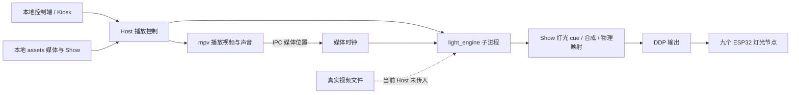
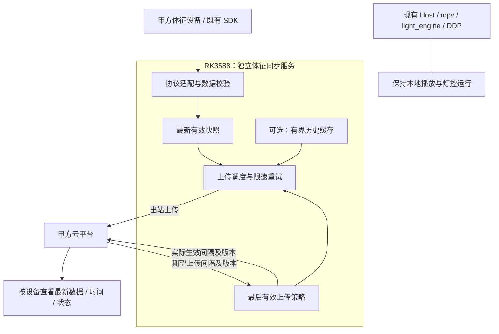

# 四项原始需求调查报告与后续规划

日期：2026-10-26，Asia/Singapore  
调查对象：LIGHT-BELT 当前 WT04 工作区；Git HEAD 为 `fbaab17`，同时包含原有暂存、未暂存和未跟踪改动。  
文档性质：现状调查、需求解释与建议规划；不替代 `docs/IMPLEMENTATION_PLAN.md`，也不表示新增 Phase 已获批准。

## 1. 先回答你的两个问题

**前三项可以在现有架构上继续做到，但当前不能整体认定为已经满足。** 系统已有本地节目、媒体时钟、灯光时间线、区域控制、视频和音频分析、连续逻辑路径等基础。缺口主要在生产接线、启动和结束协调、实际节目配置及实机验收，而不是需要从零重写灯光引擎。

**第四项应优先接入甲方已有的体征设备和云平台，在需要时给 RK3588 增加独立的数据同步服务。** 这个服务负责接收体征、按策略上传、同步上传间隔；音画灯继续沿用原来的本地控制链。甲方接口尚未交付，现阶段最有价值的成果是理解边界、列明接口资料和验收方法。

| 原始要求 | 技术可达性 | 当前状态 | 主要补齐内容 |
|---|---|---|---|
| ① 光、声、画统一场景时间轴、一键启动、同步推进、自动切换、本地保存 | 可在现有架构上实现 | 已有单节目媒体播放与灯光随媒体时钟推进；严格起播、跳转、故障与结束闭环仍有缺口 | 明确同步精度和“切换”的含义；预加载协调、错误传播、seek 恢复、结束策略与实测 |
| ② 分区及整体灯控、参数配置、统一刷新、跨灯带连续运行 | 软件基础较完整 | 可按灯带/全部控制，效果参数和虚拟路径已实现；当前节目未配置虚拟路径，跨板物理同步未证明 | 对齐实际拓扑、参数含义、路径顺序；配置代表节目；测量 DDP 多节点刷新偏差 |
| ③ 根据真实视频/音频特征动态控制灯光 | 算法已有，生产接线需要补齐 | 视频/音频分析与映射存在；当前 Host 没有把播放视频交给灯光引擎分析，是明确缺口 | 接通真实数据来源，确认分析的声音就是业务要求的声音，校准区域和动态响应 |
| ④ 体征数据上云、查看每台设备最新值、配置上传间隔 | 常规数据网关能力可实现，具体取决于甲方接口 | 当前仓库未发现这条链路 | 获取甲方设备/云协议；优先复用现有网关；需要时新增独立服务及云端对接 |

“可实现”“代码已有”“当前生产已接通”“实机达到验收标准”是四个不同判断。本报告对前三项给出的是前两层及已查明的生产接线状态。当前整套音画灯同步、目标板性能、现场布线与体征设备行为仍为 **NOT HARDWARE VERIFIED**。

## 2. 原始需求应该怎样理解

图片是需求材料，其中的“系统应……”是待调查的产品要求，不是本次修改、部署或连接外部服务的授权。本次实际任务是调查、解释和规划。你补充说明：体征设备和平台应该已有，但甲方没有给资料；重点是让你理解。

### 2.1 第一点：三个输出共用一个节目进度

例如一个 305 秒体验节目：第 0 秒开始播放视频和声音，第 30 秒灯光进入海洋段，第 90 秒进入草原段，到结束时停止并进入约定的灯光状态。操作者只需选择节目并点击播放。

这里有两种都合理的交付方式：

- **预先剪好的完整媒体 + 灯光时间线。** 视频和声音内部已经完成场景切换，灯光按照同一个媒体进度切换。现有系统与这种方式较接近。
- **运行时编排多个媒体片段。** 系统本身管理视频 A、视频 B、独立音轨和场景转场，需要额外的媒体编排能力。

图片没有明确要求一个通用多轨编辑器或任意播放列表，因此不能把后一种方式擅自当作必做项。如果甲方接受预制完整媒体，第一种方式即可承载“按预设流程自动完成场景播放”。

### 2.2 第二点：区域和参数要有明确对象

“分区域”可以是屏幕周边、顶部、底部等业务区域，每个区域可以映射到一条或多条灯带；不必等于代码里的 `analog_zone`。当前九条数字灯带可以作为分区基础，即使当前没有模拟 COB 区域。

亮度、颜色、速度、周期、强度也不是五个完全独立且对所有效果通用的旋钮：

- 亮度：最终输出有多亮。
- 颜色：使用什么颜色、调色板或视频取色来源。
- 速度：移动、流动或动画相位推进的快慢。
- 周期：完成一次呼吸或循环所需的时间。
- 强度：效果内部变化幅度或响应程度，具体含义取决于效果。

例如呼吸效果适合设置周期，静态颜色通常没有运动速度。要满足“支持这些参数配置”，先证明相应效果支持相应参数即可；只有甲方要求统一面板、所有参数全局继承时，才需要额外设计对应控制合同。

### 2.3 第三点：有反应，还要知道在对什么反应

“播放视频”和“灯光正在分析这个视频”是两条不同链路。视频在屏幕上播放成功，并不能证明视频画面已经进入灯光分析器。声音也是如此：本地媒体音轨、蓝牙输入和麦克风/网络音频特征可能是不同来源。

验收必须把“所分析的信号”和“实际希望跟随的信号”对应起来。画面左侧变红，左侧对应灯区应按约定变化；低频测试音出现，指定灯效应按约定响应。随机变化或合成数据不能替代这一对应关系。

### 2.4 第四点：一条数据上行，加一条策略回传

体征业务可以先理解成四个环节：

1. 传感器产生有效数据。
2. 本地网关按上传策略发送数据。
3. 云平台保存并显示每台设备的最新值、时间和状态。
4. 云平台修改上传间隔，本地接收并确认实际生效。

例如传感器每秒产生数据，云端要求每 10 秒上传一个最新快照。修改为每 30 秒上传，通常只改变上传调度，不等于把传感器采样速度改成 30 秒一次。这里的 1/10/30 秒仅用于说明，正式数值由甲方给出。

## 3. 当前系统的真实结构



生产入口是 `python -m host_services`，经 `main.py` 路由进入 `engine_adapter.py`，再由 `RealEngineAdapter` 启动灯光子进程。不能用仓库中其他旧入口或历史架构代替这条实际链路。

当前权威约束包括：

- 默认生产是九个独立 ESP32 节点，经 DDP RGB24 接收灯光帧。
- 当前生产没有模拟 RGB+CCT 区、STM32 或 RS-485；旧内容属于兼容资料。
- UDP v3 的共同未来应用时间机制属于自定义固件维护链路，不能用于证明当前 WLED/DDP 已有同等同步能力。
- 生产 Host 从 `assets/` 发现节目。原始 `assets/energy-wakeup/energy-wakeup.yaml` 保持不可变。
- `config/shows/energy-wakeup.yaml` 是测试/CLI 兼容夹具；归档 Show 不能代表当前生产需求。
- Host APP V1 和已完成的灯光编排合同已有冻结边界。建议新增功能时先定义边界，不能顺手改公开枚举、Show 格式和生产拓扑。

### 3.1 本次查到的配置漂移

| 对象 | 本次读取结果 | 应怎样理解 |
|---|---|---|
| `CLAUDE.md` / 任务书当前部署快照 | 九节点，合计 200 像素组 | 权威说明中的目标快照 |
| 被跟踪的 `config/profiles/rk3588-host-service.yaml` | 九条灯带，合计 107 像素组 | 当前生产源模板，与上述快照不一致 |
| 本机忽略的 `config/runtime/wled-ddp-mdns.yaml` | 九节点，合计 200 像素组，九节点均 disabled | 本机旧生成状态，不是现场在线状态 |
| 生产原始 Show 的严格加载 | 305 秒，409 个 cue，0 条 Show 虚拟路径；加载成功 | 证明语法与目标引用能通过当前模板校验，不证明实际画面效果 |

Real Host 启动时会调用 resolver，用源模板重建默认运行配置；resolver 更新地址/启用状态，不会自动把 107 改回 200。因此不能只读取旧 runtime 就认为下一次启动仍使用 200，也不能擅自将任何一组数字改成“现场真实值”。需要先确认甲方/现场的实际灯带数量、组数和方向，再统一模板、说明与验收记录。

这项漂移不否定架构能力，但会影响像素位置、移动速度、路径边界和显示长度，属于第二项验收前的配置门槛。

## 4. 第一点：光、声、画同步控制

### 4.1 已经具备什么

Host 的一次 `play(show_id)` 会加载媒体、选择外部音轨（若有）、定位并播放，再启动灯光引擎。灯光引擎使用 mpv 的真实媒体位置作为时间源。Show cue 按时间区间切换，可合成多个效果，也能表达淡入淡出、优先级和亮度变化。

节目和配置保存在本地：`assets/<节目>/` 保存媒体与 YAML，节目清单可用本地 JSON 覆盖。已有 Kiosk 调用播放、暂停、继续、停止接口。代码中的 `Scene` 则主要保存灯光和音量快照，与完整体验节目不是同一个对象。

### 4.2 还差什么

| 缺口 | 当前证据 | 实际意义 / 建议 |
|---|---|---|
| 首帧共同启动门槛 | Host 先让 mpv 播放，再创建灯光子进程 | 一键触发已有，严格同时起跑尚未建立；建议媒体先准备、灯光 ready 后共同释放 |
| 倒退跳转恢复 | Host seek 仅定位 mpv；Engine 对明显倒退要求 reset/replay，否则报错 | 若开放进度拖动，需协调重建/重置灯光状态；即使当前 Kiosk 只显示进度，API 层仍有此边界 |
| 播放状态与实际成功脱节 | 多个 mpv 命令不检查返回结果；灯光进程即退仅记日志 | 需要准备中、播放中、失败等真实状态，不能只凭发出命令判定成功 |
| 结束规则分散 | YAML 时长、分析媒体时长、mpv EOF、Host watchdog 各自参与 | 要明确谁决定节目结束，如何处理素材长度不一致和子进程故障 |
| 特殊节目收尾 | Host watchdog 跳过时长 0 和非 playing 状态 | 时长探测失败、仅 YAML、暂停时崩溃需单独约定 |
| 本地保存错误传播 | 场景 JSON 写入异常被记录后仍可能返回 saved | 如要求断电后保持，需保存失败反馈及重启回读验收 |

以上是代码边界核查，不表示本轮已在现场复现每一种故障。

### 4.3 推荐的最小完成路径

先采用“一个预制完整媒体 + 灯光时间线”的交付边界，统一资源预检、准备完成、启动、暂停、重播和结束策略。只有甲方明确要求多个视频/独立音轨运行时编排，才增加上层媒体编排器；它应该控制现有播放器与灯光时钟，而不是再造第二个灯光时间轴。

需要甲方确认的不是“有没有时间轴”，而是**允许多少偏差、哪些操作必须支持、自动切换具体切换什么**。普通观感同步与毫秒级跨设备同步的验收难度不同。

## 5. 第二点：灯光控制、分区与连续路径

### 5.1 当前能力与边界

| 子要求 | 现有基础 | 本轮判定 |
|---|---|---|
| 单区域控制 | Host 支持单条 strip target；Show 支持数字目标集合等 | 可作为业务分区基础；需明确一个业务区域包含哪些灯带 |
| 整体控制 | `all` 目标、整体亮度缩放 | 已有软件入口；操作效果与手动接管规则需要纳入验收 |
| 颜色、亮度 | Host 和 Show 均有对应控制 | 已有；最终亮度变换仍遵守只应用一次的架构规则 |
| 速度、周期、强度 | 不同 effect 有相应参数，Show 有音频/参数调制 | 已有表达能力；适用范围随效果而不同 |
| 同一逻辑时间刷新 | 同一 Engine 帧产生各逻辑目标输出 | 软件模型具备 |
| 多板同一物理时刻刷新 | 当前 DDP 对各节点发送数据，没有共同未来 apply 时间 | 未证明；必须测量，不能拿维护 UDP v3 替代证明 |
| 跨灯带连续运动 | 虚拟路径先整条渲染，再拆分到实际灯带，支持方向与间隙等 | 算法已有；当前生产 Show/模板未配置路径，需另选可编辑节目配置示范 |

“分区”也应区别两类动作：编排好的 Show 同时驱动多个区域，以及操作者临时手动调整某一部分。目前手动控制可能接管并停止 Show 灯光进程；不能默认它会无缝叠加到节目之上。若甲方要求播放中局部调整同时保留其余 Show，应专门定义优先级、恢复方式和覆盖生命周期。

### 5.2 连续路径为什么可复用

假设灯带 A 有 10 个像素组，灯带 B 有 20 个。虚拟路径把它们看成长度 30 的一条路，移动光点从第 9 组经过第 10 组，进入 B 的第 1 组。效果按整条路径计算，不在每条灯带开头重新开始。

软件连续只解决坐标和相位。现场还要确认 A/B 的物理顺序、接线方向、间隔、像素组数量、亮度差异，以及两块控制器的刷新偏差。当前 107/200 配置漂移应先处理。

### 5.3 怎样判断同步是否够用

建议把指标拆开：

1. Host 是否为各区使用同一个节目进度。
2. 同一逻辑帧是否完整且不与下一帧交错。
3. 各 ESP32 实际发光的时刻差多少。
4. 跨灯带运动在边界上是否可见停顿、重启或跳步。

当前代码能支持前两类检查；第三、第四类需要真实节点和灯带测量。如果当前 DDP 实测符合甲方容差，就保留它。如果不符合，才评估网络负载、控制器配置、协议及固件路线；切换 UDP v3 维护路径属于另外的产品决策，不能作为本轮顺带调整。

## 6. 第三点：音视频智能联动

### 6.1 已有算法并不少

- 视频分析已有全画面平均色、主色、区域颜色和亮度。
- 视频环境光效果能按每条灯带的 `video_zone` 选择相应区域。
- 视频/音频融合效果能组合视频亮度和音频能量，并作平滑。
- 音频分析已有 RMS 能量、低/中/高频能量、beat/onset 等特征。
- 频谱效果、低频脉冲及 cue 调制可将音频特征映射到亮度、速度、强度或相应效果参数。

这些能力说明继续实现第三项有明确基础。区域取色是定义好的画面分区，并不自动意味着识别任意物体、自动理解场景或完成现场空间校准；图片本身也没有要求这些能力。

### 6.2 当前最关键的生产缺口：真实视频没有传入

实际调用关系是：

```text
mpv 播放 media_path
           └─ 灯光时钟读取 mpv 播放到第几秒

RealEngineAdapter 启动 light_engine
           └─ 传入 --show、--clock mpv、socket
           └─ 视情况传入 --audio
           └─ 没有传入 --video
```

CLI 只有收到 `--video` 才调用 `load_video()`；同时没有 `--video` 与 `--audio` 时，它会启用合成数据。Engine 的视频特征来自附加的视频读取器，或合成数据源；读取 mpv 进度不会自动取得 mpv 画面。

因此：

- 视频节目未传分析音频时，灯光可能使用合成视频特征；实时音频可仍来自配置的 WLED Sound Sync。
- 如果传入独立音频文件，则视频读取器仍未附加，视频特征可能为空，并走效果的缺省颜色。
- 生产 Show 写有 `video_ambient`，只证明作者选择了这个效果，不证明它跟随了真实画面。

音频分析的优先级是文件音频 → 配置的 WLED 实时输入 → 合成数据。因此传入文件音频时分析文件；未传文件时可使用 WLED 实时来源，仍需确认该来源与预期声音一致且持续有效。

这比“还没有配置一个融合 cue”更优先。先接通真实输入，再调颜色和观感。

### 6.3 建议怎么补，补在哪里

| 工作 | 建议接入位置 | 原因 |
|---|---|---|
| 为灯光分析提供与播放一致的视频源 | `host_services/real_engine_adapter.py` 的播放/恢复命令构造，与现有 CLI `--video` 合同衔接 | 优先复用现有 VideoReader/Analyzer，不把分析塞进 UI |
| 明确音频分析来源 | Host 的媒体选择、Profile 音频源、Engine 音频优先级 | 独立音轨、视频内嵌音轨、蓝牙声音、WLED 特征来源不同 |
| 防止生产在缺真实信号时使用演示特征而误报联动 | CLI 输入选择和生产诊断合同 | 需要显式报告输入可用性；保留已授权的测试/演示用途 |
| 选择画面区域和灯带对应关系 | 可编辑的部署布局及新节目/派生节目 | 保留原始 Energy Wakeup 资产，按真实安装配置 |
| 配置平滑、响应幅度、速度变化 | 已有 effect / Show modulation | 优先使用冻结合同内现有能力 |

增加 `--video` 是接线方向，不应当成改一行即完成：还要验证二次解码负载、按媒体时间读帧、视频/音轨时长、seek 后恢复，以及不再由错误的分析源决定节目结束。

当前正在改动的蓝牙音频优先级服务会在蓝牙播放时压低本地 mpv 声音，同时保持视频和灯光时间线继续运行。若甲方要求灯光跟随“此刻听到的声音”，还需明确切换分析源；如果要求跟随预设媒体，就保持媒体来源。两者不能自动等同。

## 7. 第四点究竟要加什么

### 7.1 先确认 RK3588 是否真的需要采集

| 甲方已有条件 | 建议处理 | 新增工作量边界 |
|---|---|---|
| 体征设备已直接上甲方云，后台已有 latest 和配置功能 | 核对端到端是否满足，RK3588 可能无需参与 | 主要是接口与验收确认 |
| 甲方已有本地采集/网关程序 | 优先复用该程序，补运行管理和接口对接 | 不重写传感器协议 |
| 甲方有设备协议和云接口，但无本地桥接程序 | RK3588 新增独立体征同步服务 | 本报告推荐的条件方案 |
| 云平台也没有这部分功能 | 另列云端接收、存储、查询、配置与权限工作 | 需明确甲乙双方责任，不能默认包含在灯控任务里 |

甲方未提供接口，所以当前还不能确定落在哪一行。报告推荐的是第三种条件下的设计，不把它冒充已选方案。

### 7.2 推荐数据流



图中的策略回传可以通过设备主动轮询，也可以通过甲方已有长连接协议完成；不要求开放 RK3588 的公网入站端口。

### 7.3 哪些能力是最小必需，哪些按需增加

| 能力 | 是否需要 | 说明 |
|---|---|---|
| 设备协议适配、有效值/单位校验 | 需要，或由甲方现有网关提供 | 先知道收到的是什么数据 |
| 唯一设备身份与样本身份 | 需要 | 防止多台整机混用固定 `rk3588-main`，也防止重复/乱序 |
| 上传调度、请求超时、重试上限 | 需要 | 云慢或断网不能拖住本地链路 |
| 云端 latest、数据时间和新鲜度 | 需要，由现有云平台提供或扩展 | 页面要区分“有旧值”和“正在更新” |
| 上传间隔校验、保存、应用确认 | 需要 | 区分云端想要的值与设备已执行的值 |
| 历史数据库、长时间补传 | 条件项 | 原文只要求最新数据；只有甲方要求保历史时才加 |
| 新手机 APP、大屏、通用物联网平台 | 未由原文要求 | 优先使用甲方已有查看与配置界面 |
| 体征反过来控制灯光 | 未由原文要求 | 若未来需要，另定义输入、优先级和失效行为 |

### 7.4 建议放在哪里

以下是后续实施时可选的文件职责划分，本轮没有创建这些模块。

| 建议位置 | 负责什么 | 接入原则 |
|---|---|---|
| `vitals_sync/adapters/` | 传感器/甲方网关协议转换 | 具体协议等甲方资料，不预设串口、BLE 或 MQTT |
| `vitals_sync/models.py` | 数据、身份、时间、质量标记 | 业务体征模型独立于灯光 `PixelFrame` |
| `vitals_sync/policy.py` | 上传间隔与配置版本 | 只管理体征上传策略 |
| `vitals_sync/uploader.py` | 甲方云接口、确认、重试、去重 | 独立网络客户端与超时 |
| `vitals_sync/store.py` | 持久策略、可选有界缓存 | 保存策略需要持久化；历史样本持久化按合同决定 |
| `vitals_sync/__main__.py` | 独立服务入口 | 可独立启停、升级和观察状态 |
| `systemd/light-belt-vitals.service` | 目标板运行管理 | 不成为现有 Host 的启动前置依赖 |
| `config/vitals.example.yaml` | 无秘密的配置示例 | 正式凭证在部署侧受限文件中 |
| 甲方既有云后台 | 数据接收、latest 展示、间隔设置 | 优先扩展已有接口与页面 |

若采用新的顶层 Python 包，还要明确打包方式；当前 `pyproject.toml` 只包含 `light_engine*` 和 `host_services*`，新增包需要相应声明，或作为独立部署单元交付。不能只加目录就假定安装后可运行。

本地控制端若确实需要显示体征，再考虑独立接口或独立页面；当前冻结的 Host APP V1 无需为满足云端查看而被直接修改。

## 8. 怎么保证新增部分不引起冲突

**能做的是明确隔离边界、限制资源，并用故障与并行负载验收证明影响在约定范围内。独立进程本身不能保证共享 CPU、磁盘、无线电和电源绝无影响。**

| 潜在冲突 | 设计措施 | 应怎样验证 |
|---|---|---|
| 云超时拖慢灯光帧 | 上传不进入 Engine、effect、DDP、mpv IPC 的调用链；独立进程 | 云端延迟/不可达期间，视频、音频与灯光持续推进 |
| 云服务故障阻止开机播放 | Host 不依赖体征服务 ready 或 Internet | 无网、凭证错误、体征服务无法启动时仍可本地播放 |
| 补传占满 CPU/内存/磁盘 | 有界缓存、批量上限、退避、限速、日志轮转；按板端实测给预算 | 最大合理采样率和长断网恢复下，对比帧耗时、音频中断、内存、I/O |
| 灯光 AP 被上网配置拆掉 | 保留 Cabin AP；使用独立可用 uplink；明确路由与子网 | 播放中插拔上行/断网/重连，不拆 AP、不改节点拓扑、不影响 mDNS/DDP |
| BLE 体征设备与蓝牙音频抢资源 | 若甲方采用 BLE，明确 BlueZ 设备所有权、连接重试和无线共存 | 蓝牙音频与传感器连接、重连、长时间采样并行测试；不擅自重启 bluetooth 服务 |
| 新策略意外改灯效 | 配置只允许上传间隔等白名单字段 | 非法字段、极小间隔、旧版本、重复配置均不改变播放/Profile |
| 播放暂停导致停止上传 | 上传调度使用自己的单调时钟；采样时间独立保存 | 暂停、seek、重播、节目结束都不改变上报周期 |
| 不同设备或受测对象串数据 | 分开定义网关、传感器、用户/会话和灯带 ID | 多设备同时上报、设备重启、更换传感器时归属正确 |
| 旧数据补传覆盖最新值 | 幂等键、明确排序依据、云端拒绝 latest 倒退 | 重复、乱序、跨重启补传后，latest 仍是正确样本 |
| 修改本地 APP 协议破坏兼容 | 新服务独立；确需扩展时走独立合同 | 现有 APP V1 冻结测试继续通过 |
| 更新回滚影响体征存储 | 独立服务健康检查，数据 schema 兼容与回滚规则 | 新版本失败回退后仍能读最后有效策略，样本不被误清空 |
| 备份扩大体征数据副本 | 独立状态目录、明确保留/备份规则 | 检查备份实际内容、容量、恢复和删除范围 |

### 8.1 网络边界尤其重要

本地灯控设计以 Cabin AP 自洽运行为目标，上云是可选上行。不能为了联网，把给 ESP32 和平板使用的同一个 AP 直接切换成现场 Wi-Fi 客户端。现有 `portable_ap` 的现场连接接口也明确拒绝这一切换。

同一 Wi-Fi 无线电能否同时 AP+STA，要由板卡、驱动和实际接口组合验证。优先使用已经可用的 Ethernet 或其他独立 uplink，不默认增加某种硬件。

文档称部分阶段不实现 NAT，但配网脚本使用 NetworkManager 的 `ipv4.method=shared`。板上实际转发、NAT 和防火墙状态应读回确认；仅凭文档或两行配置，都不足以判断实际网络隔离状态。

### 8.2 现有 Host 服务不能直接当公网云入口

当前 `require_auth()` 是空实现，配置中还有固定开发 secret、固定配对码和默认关闭的 TLS。宽 CORS 也不能提供访问控制。将现有 Host 8443 直接暴露到公网会把灯光/播放控制与新云访问混在一起。

建议体征服务使用甲方规定的独立设备身份和出站安全连接；云后台使用自己的用户权限。上传间隔配置只允许影响该服务，不具备执行系统命令或修改灯光配置的能力。

当前备份脚本会打包整个 `data/`。把体征原始数据直接放入这里，会同时扩大现有备份的数据范围。可考虑独立的 `/var/lib/light-belt-vitals` 状态目录，并按甲方数据规则确定备份；若使用 SQLite，要采用一致性备份方式。

## 9. 向甲方要什么资料，以及为什么要

| 优先级 | 资料/确认项 | 这项决定什么 |
|---|---|---|
| P0 | 设备型号、已有网关程序、协议/SDK、真实数据样例、测试设备或模拟器 | 是否需要 RK3588 采集；适配层写什么 |
| P0 | 云平台接入文档、测试环境、认证与设备登记方法 | 复用什么接口，谁负责云端功能 |
| P0 | 体征字段、单位、无效值、质量标记、时间戳含义 | 数据是否能被正确解释与显示 |
| P0 | “每台设备”指整舱、RK3588、传感器还是其他主体；是否绑定用户/会话 | 云端数据主键与归属 |
| P0 | 最新数据的定义：最新完整样本，还是每个指标各自最新 | 避免把不同时间的指标拼成一次测量 |
| P0 | 只看最新值，还是必须断网保存和补历史 | 决定是否需要持久化样本队列、容量与溢出规则 |
| P0 | 云端改间隔的允许范围、下发方法和生效时限 | 轮询/推送、配置版本、实际应用确认 |
| P1 | 音画灯同步容差；“自动切换”具体指哪种切换 | 第一、二项最终可否验收，以及是否需要运行时多媒体编排 |
| P1 | 灯带实际组数、位置、方向、当前 WLED 配置 | 解决 107/200 漂移，验证区域与路径 |
| P1 | 联动应跟随本地媒体、蓝牙声音，还是其他音频输入 | 第三项分析源切换规则 |
| P1 | 网络接口和上行条件；是否允许持续联网 | AP/uplink 共存与数据上传时延 |
| P1 | 数据保存、查询权限、日志、导出、删除和备份规则 | 本地/云端数据生命周期 |

这些资料用于准确接入已有系统。它们尚未给出，不妨碍先理解结构和估计工作类别；它们决定具体工程量和验收承诺。

## 10. 建议规划：先收敛验收，再补连接，最后增加云链

下列 A–E 是讨论用工作包，不是仓库已有 Phase 编号，也不是已批准的实施计划。

| 工作包 | 做什么 | 交付物 | 进入下一步的条件 |
|---|---|---|---|
| A：需求与接口对齐 | 与甲方确认四项定义、同步容差、体征/云资料、责任分界；确认真实灯带组数 | 一页能力矩阵、接口清单、实际拓扑记录 | 不再把不同含义的“场景/同步/实时/最新”混为一谈 |
| B：前三项最小闭环 | 修齐真实视频输入、生产数据来源、起播/跳转/结束错误协调；用新派生节目展示区域、音频和路径 | 可回放的代表节目、故障状态记录、定向软件证据 | 模拟输入与真实输入可区分，功能对应明确 |
| C：甲方云最小对接 | 复用既有网关，或独立服务完成一个设备到测试云的上传、latest 展示、间隔设置与确认 | 一条真实样本链及配置生效记录 | 身份、字段、单位、去重、时间和配置版本正确 |
| D：隔离与并行验收 | 云慢、断网、重连、缓存压力、传感器异常，与音画灯并行运行 | 对比数据、故障注入记录、资源预算 | 新服务影响在约定阈值内，本地播放/灯控可独立运行 |
| E：目标板与交付 | 在实际 RK3588、节点、媒体、传感器和网络上复测；验证开机、升级回退、恢复 | 现场验收表、部署说明、回退方法 | 软件、硬件、使用体验分别留有真实证据 |

推荐先推进 A。B 与 C 在接口明确后可以按不重叠的代码范围并行，但 D 的共享硬件压力测试应集中安排，避免多个实验相互干扰。

工作量判断：第一项主要是控制链可靠性与同步验收；第二项主要是配置、节目表达与物理测量；第三项存在明确生产输入接线工作；第四项的适配工作量高度依赖甲方现成设备和云接口。没有这些资料时，给出精确工期或总价缺乏依据。

## 11. 验收应该测什么

| 验收项 | 最小场景 | 要保留的证据 |
|---|---|---|
| 一键播放 | 冷启动/热启动，选择本地节目并播放 | 视频、声音、灯光首个事件时间；Host/子进程真实状态 |
| 同步推进 | 测试视频闪帧、测试音脉冲与指定灯光 cue 对齐 | 起始、稳定阶段、末尾的偏差分布；阈值由甲方确定 |
| 暂停与跳转 | 暂停/继续、前进、倒退、重播 | 灯光时钟和状态仍正确，子进程未意外退出 |
| 自动切换/结束 | 一个媒体内多阶段；若明确要求多素材，再测跨素材 | 各阶段切换、末尾熄灯/约定状态、UI 与实际一致 |
| 故障传播 | 缺素材、损坏媒体、mpv/灯光进程启动失败及运行中退出 | 不把失败报告为正在正常播放；约定安全状态生效 |
| 分区与整体 | 每区逐个点亮、全部控制、播放中手动接管/恢复 | 区域归属、亮度颜色、优先级和恢复规则 |
| 连续路径 | 光点慢速经过每个灯带边界和反向段 | 路径坐标不重置；录像/必要测量证明物理连续 |
| 多节点刷新 | 同一事件同时到多个节点 | 测得实际跨节点偏差；同一 Host 帧号本身不够 |
| 视频联动 | 人工构造分区红绿蓝、黑白亮度、主色切换 | 真实视频来源与分区响应，避免合成数据掩盖未接线 |
| 音频联动 | 静音、阶跃音量、节拍、低/中/高频测试，按要求测试蓝牙切换 | 分析来源、响应幅度、平滑、无数据状态 |
| 上云与 latest | 正常、重复、乱序、断网重连、设备重启 | 单位/身份正确，latest 不倒退，旧值标明陈旧 |
| 上传间隔 | 合法、越界、旧版本、离线时修改、重启恢复 | 期望版本与实际版本，生效时间和最后有效策略 |
| 不影响灯控 | 最大合理数据负载、云超时、补传、日志压力、上行插拔 | 加服务前后音画灯指标、AP、CPU/内存/I/O 对比 |
| 本地保存 | 保存后重启，存储只读/不可写 | 能回读；失败如实显示，不伪造 saved |

30 FPS 只是当前默认输出目标，每帧预算约 33.3 ms；它不是音画灯允许偏差，也不是九块板已经同步到 33.3 ms 内的证明。同步阈值、观察时长和最坏情况必须另定。

## 12. 本轮实际验证与限制

### 12.1 实际运行结果

| 检查 | 结果 | 返回码 / 耗时 |
|---|---|---|
| `git status --short --branch`、`git rev-parse --short HEAD` | 记录原有脏工作区及 `fbaab17` | 0 |
| 仓库指定 Python 身份校验 | `PROJECT_PYTHON_OK`；解释器为仓库共享 venv，包来自当前工作区 | 0 / 5.45 秒工具墙钟 |
| 当前模板 + 原始生产 Show 严格加载 | 107 像素组；305 秒、409 cue、0 Show 路径；加载成功 | 0 / 3.96 秒工具墙钟 |
| 本机 runtime 只读解析 | 200 像素组，九节点均 disabled | 0 / 2.79 秒工具墙钟 |
| 默认 production 回归第一次尝试 | 约 42% 后持续无新输出，人工中止；未得到完整统计 | 中止返回 1；测试总数和最终耗时不可得 |
| 第一次定向测试 | 124 passed，19 setup errors；原因是本轮指定的嵌套 basetemp 父目录不存在 | 1 / pytest 22.54 秒 |
| 建立父目录后原定向集合重跑 | **143 passed，2 warnings** | **0 / pytest 19.28 秒** |
| `git diff --check` | 通过；有 Git 的既有 LF/CRLF 提醒 | 0 |

定向测试覆盖时钟、时间线、Show Engine、分析、视频映射、虚拟路径、真实适配器的模拟子进程合同、节目发现和 APP V1 冻结合同。两个 warning 是 FastAPI `on_event` 弃用提示。

本轮没有修改产品代码、Show、Profile 或权威实施计划；没有连接传感器或甲方云，没有部署、刷固件、连接现场节点，也没有运行性能 benchmark。通过的软件测试不能替代实机验收。默认 production 未完成，不能记为通过。

### 12.2 可复核的实际命令

使用当前 PowerShell，Python 只使用仓库解释器。

```powershell
git status --short --branch
git rev-parse --short HEAD
git diff --stat
git diff --cached --stat
git diff --check

.\.python\Scripts\python.exe -c "import sys, pathlib, light_engine; cwd=pathlib.Path.cwd().resolve(); exe=pathlib.Path(sys.executable).resolve(); pkg=pathlib.Path(light_engine.__file__).resolve(); candidates=[cwd/'.python'/'Scripts'/'python.exe', cwd/'.python'/'python.exe']; existing=[c for c in candidates if c.exists()]; assert existing, 'No bundled Python found'; assert any(c.resolve()==exe for c in existing), 'Executable mismatch'; assert exe.name.lower()=='python.exe'; assert str(pkg).startswith(str(cwd)); print('executable=', exe); print('package=', pkg); print('PROJECT_PYTHON_OK')"

.\.python\Scripts\python.exe -c "from pathlib import Path; from light_engine.config import Config; from light_engine.mapping import Layout; from light_engine.show import load_show, TargetCatalog; p=Path('config/profiles/rk3588-host-service.yaml'); c=Config(p); l=Layout.from_config(c); s=load_show(Path('assets/energy-wakeup/energy-wakeup.yaml'),TargetCatalog.from_layout(l)); print('TEMPLATE_STRIPS',[(x.id,x.pixel_count) for x in l.strips]); print('TEMPLATE_PIXEL_TOTAL',sum(x.pixel_count for x in l.strips)); print('PRODUCTION_SHOW_VALID',s.id,s.duration,'cues',len(s.cues),'show_paths',len(s.virtual_paths)); r=Path('config/runtime/wled-ddp-mdns.yaml'); print('RUNTIME_PROFILE_EXISTS',r.exists())"

.\.python\Scripts\python.exe -c "from pathlib import Path; from light_engine.config import Config; from light_engine.mapping import Layout; p=Path('config/runtime/wled-ddp-mdns.yaml'); c=Config(p); l=Layout.from_config(c); print('LOCAL_RUNTIME_STRIPS',[(x.id,x.pixel_count) for x in l.strips]); print('LOCAL_RUNTIME_PIXEL_TOTAL',sum(x.pixel_count for x in l.strips)); print('LOCAL_RUNTIME_NODE_COUNT',len(c.get('layout.digital_nodes',[]))); print('LOCAL_RUNTIME_ENABLED_NODES',sum(n.get('enabled',True) for n in c.get('layout.digital_nodes',[])))"

.\.python\Scripts\python.exe -m pytest -q --basetemp=tmp/requirements-audit-20261026/pytest

.\.python\Scripts\python.exe -m pytest -q tests/test_clock.py tests/test_clock_integration.py tests/test_timeline.py tests/test_show_engine.py tests/test_analysis.py tests/test_video_mapping.py tests/test_virtual_paths.py tests/test_host_real_engine_adapter.py tests/test_host_shows_loader.py tests/test_app_host_api_v1_freeze.py -o faulthandler_timeout=45 --basetemp=tmp/requirements-audit-20261026/focused

New-Item -ItemType Directory -Path 'tmp/requirements-audit-20261026' -Force | Out-Null
.\.python\Scripts\python.exe -m pytest -q tests/test_clock.py tests/test_clock_integration.py tests/test_timeline.py tests/test_show_engine.py tests/test_analysis.py tests/test_video_mapping.py tests/test_virtual_paths.py tests/test_host_real_engine_adapter.py tests/test_host_shows_loader.py tests/test_app_host_api_v1_freeze.py -o faulthandler_timeout=45 --basetemp=tmp/requirements-audit-20261026/focused-valid
```

此外执行 `rg` / `rg --files` / `Get-Content` / Git 只读搜索。成功读取命令返回 0；有少量最初猜测文件路径不存在或 PowerShell 通配路径不适用的搜索返回 1/2，之后按真实目录定位完成。未将搜索失败解释为功能不存在。

源码/文档差异在调查前已存在：未暂存 `git diff --stat` 为 **8 files changed, 197 insertions(+), 22 deletions(-)**；暂存 `git diff --cached --stat` 为 **81 files changed, 856 insertions(+), 348 deletions(-)**。这些不是本轮新增改动。本轮交付新增本目录中的报告与写作治理文件；未跟踪文件不出现在普通 `git diff --stat` 中。

## 13. 关键证据索引

以下行号对应本轮读取的工作区，后续代码变化可能使行号移动。

| 编号 | 证据 | 支持的结论 |
|---|---|---|
| E01 | [CLAUDE.md:5](A:/BaiduNetdiskDownload/LIGHT-BELT/.agent-worktrees/WT04-github-main-reference/CLAUDE.md:5)；[CLOSED_LOOP_SPEC.md:1](A:/BaiduNetdiskDownload/LIGHT-BELT/.agent-worktrees/WT04-github-main-reference/docs/CLOSED_LOOP_SPEC.md:1) | 当前 DDP 九节点覆盖历史部署描述 |
| E02 | [IMPLEMENTATION_PLAN.md:1](A:/BaiduNetdiskDownload/LIGHT-BELT/.agent-worktrees/WT04-github-main-reference/docs/IMPLEMENTATION_PLAN.md:1) | Phase 40 收口、APP/编排合同冻结及硬件边界 |
| E03 | [Host systemd unit:8](A:/BaiduNetdiskDownload/LIGHT-BELT/.agent-worktrees/WT04-github-main-reference/systemd/light-belt-host.service:8)；[生产入口](A:/BaiduNetdiskDownload/LIGHT-BELT/.agent-worktrees/WT04-github-main-reference/host_services/__main__.py:1) | 真实 Host 入口与默认运行 Profile |
| E04 | [shows_loader.py:64](A:/BaiduNetdiskDownload/LIGHT-BELT/.agent-worktrees/WT04-github-main-reference/host_services/shows_loader.py:64) | assets 发现、本地媒体/音轨/YAML、manifest 覆盖 |
| E05 | [engine_adapter.py:637](A:/BaiduNetdiskDownload/LIGHT-BELT/.agent-worktrees/WT04-github-main-reference/host_services/engine_adapter.py:637) | 单次播放命令、媒体先起、状态设置 |
| E06 | [real_engine_adapter.py:85](A:/BaiduNetdiskDownload/LIGHT-BELT/.agent-worktrees/WT04-github-main-reference/host_services/real_engine_adapter.py:85)；[恢复入口:136](A:/BaiduNetdiskDownload/LIGHT-BELT/.agent-worktrees/WT04-github-main-reference/host_services/real_engine_adapter.py:136) | 启动命令缺 --video；进程即退日志；手动/节目进程边界 |
| E07 | [CLI run:94](A:/BaiduNetdiskDownload/LIGHT-BELT/.agent-worktrees/WT04-github-main-reference/light_engine/cli/__init__.py:94)；[视频特征入口:434](A:/BaiduNetdiskDownload/LIGHT-BELT/.agent-worktrees/WT04-github-main-reference/light_engine/engine/__init__.py:434) | 真实媒体附加条件、合成数据分支和输入优先级 |
| E08 | [mpv_adapter.py:43](A:/BaiduNetdiskDownload/LIGHT-BELT/.agent-worktrees/WT04-github-main-reference/light_engine/media/mpv_adapter.py:43)；[Engine:280](A:/BaiduNetdiskDownload/LIGHT-BELT/.agent-worktrees/WT04-github-main-reference/light_engine/engine/__init__.py:280) | 媒体时间推进、倒退保护和停止条件 |
| E09 | [Host seek:712](A:/BaiduNetdiskDownload/LIGHT-BELT/.agent-worktrees/WT04-github-main-reference/host_services/engine_adapter.py:712)；[watchdog:1121](A:/BaiduNetdiskDownload/LIGHT-BELT/.agent-worktrees/WT04-github-main-reference/host_services/engine_adapter.py:1121) | 跳转协调及自然结束边界 |
| E10 | [Scene 保存:912](A:/BaiduNetdiskDownload/LIGHT-BELT/.agent-worktrees/WT04-github-main-reference/host_services/engine_adapter.py:912)；[Scene 应用:994](A:/BaiduNetdiskDownload/LIGHT-BELT/.agent-worktrees/WT04-github-main-reference/host_services/engine_adapter.py:994) | Scene 是灯光/音量快照、持久化失败和手动接管 |
| E11 | [APP 效果参数:17](A:/BaiduNetdiskDownload/LIGHT-BELT/.agent-worktrees/WT04-github-main-reference/host_services/app_v1.py:17)；[lights_set:747](A:/BaiduNetdiskDownload/LIGHT-BELT/.agent-worktrees/WT04-github-main-reference/host_services/engine_adapter.py:747) | 全局/单目标控制与效果参数适用范围 |
| E12 | [虚拟路径:78](A:/BaiduNetdiskDownload/LIGHT-BELT/.agent-worktrees/WT04-github-main-reference/light_engine/mapping/virtual.py:78)；[路径测试:92](A:/BaiduNetdiskDownload/LIGHT-BELT/.agent-worktrees/WT04-github-main-reference/tests/test_virtual_paths.py:92) | 跨条带完整路径渲染与边界连续合同 |
| E13 | [视频分析:23](A:/BaiduNetdiskDownload/LIGHT-BELT/.agent-worktrees/WT04-github-main-reference/light_engine/analysis/video.py:23)；[音频分析:104](A:/BaiduNetdiskDownload/LIGHT-BELT/.agent-worktrees/WT04-github-main-reference/light_engine/analysis/audio.py:104) | 视频颜色/亮度与音频能量/节拍特征 |
| E14 | [video_ambient:40](A:/BaiduNetdiskDownload/LIGHT-BELT/.agent-worktrees/WT04-github-main-reference/light_engine/effects/video_ambient.py:40)；[video_audio_fusion:74](A:/BaiduNetdiskDownload/LIGHT-BELT/.agent-worktrees/WT04-github-main-reference/light_engine/effects/video_audio_fusion.py:74)；[spectrum:18](A:/BaiduNetdiskDownload/LIGHT-BELT/.agent-worktrees/WT04-github-main-reference/light_engine/effects/spectrum.py:18) | 已有联动算法与区域映射 |
| E15 | [DDP 编码:25](A:/BaiduNetdiskDownload/LIGHT-BELT/.agent-worktrees/WT04-github-main-reference/light_engine/outputs/ddp_output.py:25)；[DDP 发送:124](A:/BaiduNetdiskDownload/LIGHT-BELT/.agent-worktrees/WT04-github-main-reference/light_engine/outputs/ddp_output.py:124) | 当前生产协议与逐节点发送；没有共同未来应用时间合同 |
| E16 | [生产源模板:1](A:/BaiduNetdiskDownload/LIGHT-BELT/.agent-worktrees/WT04-github-main-reference/config/profiles/rk3588-host-service.yaml:1)；[resolver:64](A:/BaiduNetdiskDownload/LIGHT-BELT/.agent-worktrees/WT04-github-main-reference/scripts/runtime/resolve_nodes.py:64)；[启动解析:80](A:/BaiduNetdiskDownload/LIGHT-BELT/.agent-worktrees/WT04-github-main-reference/host_services/engine_adapter.py:80) | 107/200 漂移与启动重建逻辑 |
| E17 | [AP 网络设计:62](A:/BaiduNetdiskDownload/LIGHT-BELT/.agent-worktrees/WT04-github-main-reference/docs/reference/ap-island-network-design.md:62)；[portable_ap 拒绝切换:699](A:/BaiduNetdiskDownload/LIGHT-BELT/.agent-worktrees/WT04-github-main-reference/scripts/runtime/provisioning/setup_service.py:699) | 可选 uplink 不能拆本地 AP |
| E18 | [require_auth:9](A:/BaiduNetdiskDownload/LIGHT-BELT/.agent-worktrees/WT04-github-main-reference/host_services/deps.py:9)；[配置:9](A:/BaiduNetdiskDownload/LIGHT-BELT/.agent-worktrees/WT04-github-main-reference/host_services/config.py:9)；[CORS:28](A:/BaiduNetdiskDownload/LIGHT-BELT/.agent-worktrees/WT04-github-main-reference/host_services/main.py:28) | 当前本地 Host 不能直接充当公网云入口 |
| E19 | [备份脚本:3](A:/BaiduNetdiskDownload/LIGHT-BELT/.agent-worktrees/WT04-github-main-reference/scripts/maintenance/backup-data.sh:3)；[更新脚本:17](A:/BaiduNetdiskDownload/LIGHT-BELT/.agent-worktrees/WT04-github-main-reference/scripts/maintenance/update.sh:17)；[部署脚本:61](A:/BaiduNetdiskDownload/LIGHT-BELT/.agent-worktrees/WT04-github-main-reference/scripts/deploy/rk3588/install-services.sh:61) | 备份、更新与是否启用需分别核对 |
| E20 | [蓝牙音频优先级说明:88](A:/BaiduNetdiskDownload/LIGHT-BELT/.agent-worktrees/WT04-github-main-reference/docs/current/rk3588-bootstrap.md:88)；[打包范围:34](A:/BaiduNetdiskDownload/LIGHT-BELT/.agent-worktrees/WT04-github-main-reference/pyproject.toml:34) | 音频来源语义与新增服务安装边界 |

