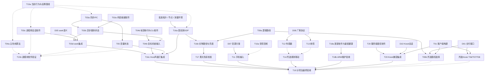

# LIGHT-BELT 功能完成度、开发缺口与执行流程（原始8～54）

需求依据为《micro_oxygen_codex_checklist_08-54.md》，其中注明来源为《微压氧舱光声电联动及体征数据云控系统实施方案功能明细.docx》。初查为2026-11-02，源码独立复核与任务审订为2026-11-03（Asia/Singapore）。核查对象为当前工作区 `A:/BaiduNetdiskDownload/LIGHT-BELT/.agent-worktrees/WT04-github-main-reference`，HEAD为 `fbaab17dd953b0c968fa00e11db941ffea775926`。工作区已有暂存、未暂存及未跟踪文件，结论对应当前文件内容，HEAD不足以单独复原该快照。

原始清单为[micro_oxygen_codex_checklist_08-54.md](C:/Users/19141/Downloads/micro_oxygen_codex_checklist_08-54.md)。

本报告覆盖8～54共47条，保留原始名称和需求文本。1～7、55～62仅在依赖分析必要时涉及。`docs/reports/2026-10-26-four-requirements`未用作调查依据。后续任务为待批准的开发建议。

## 1. 判定口径与主要结论

每项分别核对算法、数据生产/转换/消费、Host入口、配置、客户端与设备链。五类状态用于整项需求。已完成且验证要求证据覆盖该需求。代码已实现、尚待联调表示主要软件链成立。部分完成表示存在可确认的软件或产品缺口。未实现表示当前仓库没有满足要求的业务链。无法确认用于缺少足以裁定最终验收的合同或证据，并列出缺失内容。

原文没有统一规定每个参数必须通过Kiosk、REST还是Show配置交付。第8、16～23项因此暂列无法确认，逐项列出软件事实和不同接口下的条件结论，等待D01。该口径替代此前默认把Kiosk作为唯一交付接口的判断。第15项明确要求预设色板，命名色板能力的缺失仍是有效缺口。Show v2可作为第9、11、12项的场景程序，原文未要求新增JSON场景格式或多视频队列。

### 1.1 可确认的缺口

| 问题 | 证据与后果 | 任务 |
| --- | --- | --- |
| REST鉴权为空实现 | require_auth函数体为pass。P5确认匿名/无效Bearer可执行亮度写接口，匿名还能取得有效WS ticket。Kiosk当前无令牌流程。 | T20，Kiosk与服务端同一兼容变更 |
| Host同步IPC错误丢失 | Host取首条JSON行，未匹配request_id，包装方法不返回错误。P3确认load失败仍playing，P5确认start-file事件会被当作回复。Engine时钟客户端已有匹配request_id的实现可借鉴。 | T03a |
| 异步媒体错误未归因 | Host无持续file-loaded/end-file错误事件处理，命令success只证明收到命令。看门狗可能随后按idle收尾，未给出解码失败原因。 | T03b |
| 灯光进程和会话归属缺口 | 子进程退出仅日志，停止失败仍继续替换。P6确认旧idle结果可以清理新会话。 | T03c |
| seek恢复未闭合 | Host只seek播放器，Engine对倒退抛错。重启后可追到媒体位置，但状态型效果的历史恢复语义需D05明确。 | T03d |
| 主色量化错误 | 通道255产生箱号8，解码按0～7箱处理，纯绿/蓝/白明显偏色。平均色和主色共用平滑器。 | T04a，独立软件修复 |
| 生产视频输入未接 | Host视频播放命令没有--video。无音频参数时CLI启用synthetic，有独立音频参数时视频可能为空。 | T04b |
| 音量持有状态未重放 | 播放器创建前设置volume/mute后，新播放器仅收到play/resume，界面值与实际属性可能不一致。 | T05 |
| 内容/配置就绪检查不足 | 六个YAML可加载，旧五板Show有非法枚举。只有energy-wakeup有媒体。模板107像素与本地旧runtime200像素不同，real入口已有启动/会话边界重解析能力。 | T02，复用解析器 |
| 更新健康合同不匹配 | 默认更新器要求/status带commit，真实Host没有该字段，P7已确认。事务替身自行制造commit，未覆盖该集成边界。 | T18a优先软件修复，随后T18b |
| 手机声音输入未闭合 | BlueZ/PulseAudio路由与静音优先级存在，PCM或已确认声学拾音源进入特征分析的交付证据不足。 | D07、T11 |
| 传感器、舱控业务链缺失 | 没有对应驱动、状态模型、显示及具体联动消费者，缺厂商协议。 | D08、T12～T14 |

### 1.2 保留、删除与收窄的判断

已有17种清单灯效、22种内部注册效果、Show调度、虚拟路径、音频特征及调制均保留有效实现判断。loudness/spectrum/peak在AudioFeatures构造后映射到RMS/三频段/beat，文件分析也同步RMS/loudness。此前“实时字段未接通”的说法已证伪。

归一化波宽满足第29项，低饱和低亮慢漂满足第37项，通过配置选择合法效果组可满足第40项。像素单位波宽、额外S/V控件、多视频队列、泛化联动框架、配置热切换均不作为默认新增需求。默认twinkle用全局随机源，显式event-field才有独立随机流，随机性符合第39项。

JSON Scene写盘失败仍报saved的缺陷保留为接口维护事项，归入T02c并单列触发条件。它不阻挡已保存的Show证明第11项。demo长帧追赶、递归组选项/无效名称诊断列为可选维护，退出需求关键路径。

## 2. 架构与当前阶段

```text
Kiosk播放、亮度、音量（REST轮询，当前无令牌）
    → Host路由/状态 → MpvClient → mpv播放音视频
                       ↓             ↓媒体位置
                RealEngineAdapter → MpvIPCClock/Engine
                       ↑                 ↓
              生产视频帧入口缺失     ShowRuntime/效果/调制
                                         ↑
                     文件AudioAnalyzer或WLED Audio Sync接收
                                         ↓
                 逻辑帧 → OutputTransform → PhysicalMapping
                                         ↓
                        DDP → 九个独立WLED/ESP32节点
```

当前生产模板为九条数字灯带、107像素、30 FPS、mpv时钟、WLED Audio Sync V2源及DDP。没有当前模拟区/STM32/RS-485输出。项目自定义UDP v3及STM32固件仍有兼容/维护用途，其定时机制不作为WLED物理同步证据。节点/IP/GPIO留在物理层，Engine拥有逻辑sequence，亮度职责需区分Engine固定输出增益与Host设备bri。

real Host在导入及播放/手动会话边界调用既有resolve_nodes，并在安全边界刷新下一引擎进程的Profile。旧runtime文件仅证明本机缓存漂移，不足以判定生产系统一直使用200像素，也不需要再建一个配置同步守护服务。参见[host_services/engine_adapter.py:80](A:/BaiduNetdiskDownload/LIGHT-BELT/.agent-worktrees/WT04-github-main-reference/host_services/engine_adapter.py:80)、[host_services/engine_adapter.py:115](A:/BaiduNetdiskDownload/LIGHT-BELT/.agent-worktrees/WT04-github-main-reference/host_services/engine_adapter.py:115)和[config/profiles/rk3588-host-service.yaml:6](A:/BaiduNetdiskDownload/LIGHT-BELT/.agent-worktrees/WT04-github-main-reference/config/profiles/rk3588-host-service.yaml:6)。

Host API Markdown概述笼统要求Bearer，OpenAPI对/status明确security=[]，与现有公开状态路由及更新器无令牌健康访问一致。保护控制接口和ticket签发时保留该公开例外。参见[docs/reference/host-api-v1.openapi.yaml:50](A:/BaiduNetdiskDownload/LIGHT-BELT/.agent-worktrees/WT04-github-main-reference/docs/reference/host-api-v1.openapi.yaml:50)、[docs/reference/host-api-v1.md:62](A:/BaiduNetdiskDownload/LIGHT-BELT/.agent-worktrees/WT04-github-main-reference/docs/reference/host-api-v1.md:62)。

Host开发默认mock，systemd显式real。配对JWT签发、刷新和一次性WS ticket已有代码，REST依赖为空，WS端点本身仍验证ticket。获取ticket的REST入口当前匿名可达。WS当前发送session.connected和heartbeat，broadcast存在但未从播放生命周期调用，故error.event词汇存在尚不足以证明错误已推送。参见[host_services/deps.py:10](A:/BaiduNetdiskDownload/LIGHT-BELT/.agent-worktrees/WT04-github-main-reference/host_services/deps.py:10)、[host_services/routers/auth.py:30](A:/BaiduNetdiskDownload/LIGHT-BELT/.agent-worktrees/WT04-github-main-reference/host_services/routers/auth.py:30)、[host_services/ws.py:36](A:/BaiduNetdiskDownload/LIGHT-BELT/.agent-worktrees/WT04-github-main-reference/host_services/ws.py:36)、[kiosk/src/api.js:3](A:/BaiduNetdiskDownload/LIGHT-BELT/.agent-worktrees/WT04-github-main-reference/kiosk/src/api.js:3)。

实施计划声明Phase 40编排软件合同关闭，APP V1的发现词汇和外观合同固定。后续修复应保留已发布接口，新增控件和内部参数暴露受D01及兼容设计约束。当前阶段是已有灯光引擎基础、生产入口和故障处理仍有缺口、设备整体验收待完成。所有现场行为保持 **NOT HARDWARE VERIFIED**。参见[docs/IMPLEMENTATION_PLAN.md:1](A:/BaiduNetdiskDownload/LIGHT-BELT/.agent-worktrees/WT04-github-main-reference/docs/IMPLEMENTATION_PLAN.md:1)、[host_services/app_v1.py:16](A:/BaiduNetdiskDownload/LIGHT-BELT/.agent-worktrees/WT04-github-main-reference/host_services/app_v1.py:16)。

## 3. 验证证据、边界与复现依据

### 3.1 已有验证基线

| 证据 | 实际命令/结果 | 范围 |
| --- | --- | --- |
| E1 | `.\.python\Scripts\python.exe -m pytest -q --suite fast`，0，381 passed，7.80秒 | 快速合同 |
| E2 | `.\.python\Scripts\python.exe -m pytest -q -o faulthandler_timeout=45 --inventory-json=tmp/feature-gap-production-unsandboxed.json`，0，1224 passed/1 skipped/3 warnings，70.68秒 | 当前production，78文件 |
| E3 | 四路径显式pytest，0，47 passed，148.29秒 | 更新20、依赖保护4、蓝牙优先级14、部署9，使用隔离外部命令替身 |
| E4 | 七路径显式pytest，0，130 passed，17.98秒 | 分析、效果、Show、公共控制、虚拟路径、实时音源 |
| 前端构建 | `npm.cmd --prefix kiosk run build`，1，vite不可用 | node_modules缺失，尚无源码重建成功证据，dist静态服务测试有效 |
| 解释器检查 | AGENTS规定的完整assert命令，0，PROJECT_PYTHON_OK | 仓库自带解释器，当前工作区包导入正确 |

E3和E4的实际命令如下。

```powershell
.\.python\Scripts\python.exe -m pytest -q tests/test_update_transaction.py tests/test_dependency_installation.py tests/test_bluetooth_audio_priority.py tests/test_rk3588_bluetooth_deployment.py -rs --inventory-json=tmp/feature-gap-maintenance-unsandboxed.json
.\.python\Scripts\python.exe -m pytest -q tests/test_analysis.py tests/test_effects.py tests/test_virtual_paths.py tests/test_show_common_effect_controls.py tests/test_show_engine.py tests/test_engine_wled_audio_source.py tests/test_wled_audio_sync.py --inventory-json=tmp/feature-gap-independent-20261103.json
```

这些是已执行的基线记录。本次报告审订未改源码、依赖或配置，按仓库规则复用。fast包含在production，E3/E4也有重叠，数量不相加。显式路径的inventory suite字段为full表示收集规则，执行范围仍为列出的文件。没有执行全仓库`--suite full`/history、真实固件构建、真实OTA或硬件验收。

沙箱内首次production在TestClient初始化阻塞，人工中止返回1。诊断运行180.04秒超时，外层1、诊断器标记124，已有519条PASSED，栈为asyncio/socketpair/accept。同一套件沙箱外得到E2结果。E3沙箱内为22 failed/25 passed、17.43秒，20项MSYS命名对象访问拒绝、2项临时Junction创建拒绝，沙箱外47通过。E2跳过项为目录symlink不可用的distribution测试。三条warning为FastAPI/TestClient弃用提示。这些环境失败和跳过均保留，不计为通过。

### 3.2 只读探针

| 证据 | 输入、观察及实际结果 | 结论 |
| --- | --- | --- |
| P1 | 两种Profile加载，模板107/本地runtime200。六个Show有效，energy-wakeup 305秒/409 cue/媒体305620ms，旧五板Show因color_source=fixed失败。退出0，墙钟约9.54秒。 | 资产有效性与物理验收分开 |
| P2 | 捕获Host视频命令无--video/--audio，CLI对应分支可返回synthetic视频。live别名0.6/0.3/0.3/0.3/True有效。新mpv起播调用只有play/resume。退出0，约7.62秒。 | 视频入口、音量同步缺口与有效音频映射 |
| P3 | 纯色主色量化及IPC loading failed注入，Host仍playing。100Hz文件分析RMS=loudness=1、bass约1。退出0，核心0.0094秒，工具9.33秒。 | 软件缺陷复现与有效输入转换 |
| P4 | 公开analyze纯色输出、六有效/一无效Show复核、同seed默认twinkle改变全局RNG后不同。退出0，工具8.53秒。 | 主色偏差延伸到公开接口，随机重放声明收窄 |
| P5 | 全内存ASGI匿名/无效Bearer写亮度均200/ok。匿名ws-ticket 200，ticket首次消费有效、第二次无效。Host首事件当回复，Engine时钟按request_id得到12.5。成功ACK后异步错误仍报告playing。退出0，核心0.0998秒、工具7.50秒。 | REST执行缺口、ticket保护入口、两种IPC客户端行为不同 |
| P6 | 替身旧进程terminate抛错且poll仍None，仍指派新进程。旧idle回复中注入会话切换，结果清空新show并stopped。退出0，核心0.0038秒、工具2.79秒。 | 停止确认和会话代际校验缺口 |
| P7 | 直接执行真实status路由的无IO协程，响应data只有service/host_id/api_version/version/time_ms。更新器commit正则对真实响应不匹配，对现有fake匹配。退出0，核心0.00028秒、工具4.16秒。 | 默认更新健康生产者/消费者不一致 |

P5/P6/P7通过PowerShell标准输入调用 `.\.python\Scripts\python.exe -B -X utf8 -`，使用内存HTTP transport和Socket/进程替身。P5因已知Windows asyncio沙箱限制在沙箱外运行。P5的HTTP请求经过真实ASGI路由及依赖，transport为内存实现。mpv、Socket和进程采用替身，真实节点/设备未参与。`-B`禁止新增字节码。退出0表示复现断言成立。P6是控制交错的反例，不声称在现场观察过该竞态。

### 3.3 关键缺陷的精确边界

主色量化对255得到箱号8，八箱解码发生跨通道进位。P3/P4的原始输出如下。公开接口还叠加了共用平滑器和模型钳制。

| 输入 | 量化函数RGB | 公开analyze的dominant_rgb |
| --- | --- | --- |
| 红 | (1.0625,.0625,.0625) | 未在P4重复采样 |
| 绿 | (.1875,.0625,.0625) | (.159375,.180625,.053125) |
| 蓝 | (.0625,.1875,.0625) | (.053125,.159375,.180625) |
| 白 | (1.1875,.1875,.0625) | (1,.286875,.180625) |

现有视频测试主要检查average_rgb和zone_colors，未覆盖这些dominant_rgb边界，因此E4通过与上述缺陷同时成立。参见[light_engine/analysis/video.py:179](A:/BaiduNetdiskDownload/LIGHT-BELT/.agent-worktrees/WT04-github-main-reference/light_engine/analysis/video.py:179)、[tests/test_analysis.py:88](A:/BaiduNetdiskDownload/LIGHT-BELT/.agent-worktrees/WT04-github-main-reference/tests/test_analysis.py:88)。区域平均色路径不直接使用此直方图，不能将所有区域取色一律描述为发生相同进位。

mpv有两种失败时序。同步IPC回复中的error要由Host包装层传播。success之后的加载/解码失败要通过持续事件或等价可观察状态处理。Host当前每请求建连接、只解析第一行并关闭，异步事件会被误认或丢弃。Engine的MpvIPCAdapter已有request_id过滤，但没有Host媒体生命周期事件分发能力。参见[host_services/engine_adapter.py:171](A:/BaiduNetdiskDownload/LIGHT-BELT/.agent-worktrees/WT04-github-main-reference/host_services/engine_adapter.py:171)、[light_engine/media/mpv_adapter.py:64](A:/BaiduNetdiskDownload/LIGHT-BELT/.agent-worktrees/WT04-github-main-reference/light_engine/media/mpv_adapter.py:64)。

Engine正常异常路径会在finally尝试黑帧并关闭输出。强杀、进程崩溃或网络故障仍可能让该清理无法送达。Host须确认停止旧输出进程、识别当前会话和预期结束原因，现场安全状态由T16验证。参见[light_engine/engine/__init__.py:408](A:/BaiduNetdiskDownload/LIGHT-BELT/.agent-worktrees/WT04-github-main-reference/light_engine/engine/__init__.py:408)、[light_engine/engine/__init__.py:474](A:/BaiduNetdiskDownload/LIGHT-BELT/.agent-worktrees/WT04-github-main-reference/light_engine/engine/__init__.py:474)。

## 4. 47 项逐条核查

### 8. 自定义视频添加

- **原始需求** 可以从预置内容之外添加自定义视频作为舱内播放内容。
- **当前状态** **无法确认**，缺少最终交付接口的验收决定，软件实现事实如下。
- **验收口径** D01-A接受管理员按目录投放视频后刷新列表时，软件发现基础可归入代码已实现、待目标机联调。D01-B要求Kiosk导入时仍为部分完成，当前缺导入及反馈流程。 由D01裁定后更新最终状态。
- **代码与调用链** [host_services/shows_loader.py:64](A:/BaiduNetdiskDownload/LIGHT-BELT/.agent-worktrees/WT04-github-main-reference/host_services/shows_loader.py:64) 扫描一级目录，识别 mp4/mkv/mov 和 YAML。`:121` 探测时长。`:173` 合并可选 manifest。[host_services/routers/shows.py:10](A:/BaiduNetdiskDownload/LIGHT-BELT/.agent-worktrees/WT04-github-main-reference/host_services/routers/shows.py:10) → [kiosk/src/composables/useShows.js:8](A:/BaiduNetdiskDownload/LIGHT-BELT/.agent-worktrees/WT04-github-main-reference/kiosk/src/composables/useShows.js:8) → [kiosk/src/App.vue:19](A:/BaiduNetdiskDownload/LIGHT-BELT/.agent-worktrees/WT04-github-main-reference/kiosk/src/App.vue:19) → 播放 API。
- **已实现** 经文件系统部署到 assets 的非预置媒体可被发现。视频与外置音轨可配对，支持 manifest 覆盖名称等字段。并非写死节目列表。
- **缺口/运行条件** 没有当前 Kiosk 的媒体导入入口和对应导入 API。[host_services/engine_adapter.py:274](A:/BaiduNetdiskDownload/LIGHT-BELT/.agent-worktrees/WT04-github-main-reference/host_services/engine_adapter.py:274)、`:502`、`:526` 在列表查询或播放查找时重新调用发现器，因此文件系统新增后重新查询即可发现，不要求重启Host。当前页面只在挂载时加载列表，未提供导入后触发刷新的流程。单目录多视频只取排序第一项。探测失败时长为0，页面禁用该卡片。若交付只要求管理员复制文件再刷新页面，扫描基础已经具备，缺该交付流程的实际验收。
- **证据与判断** P1 实际发现七条节目，只有 energy-wakeup 有媒体且可获得非零时长。[tests/test_host_shows_loader.py:40](A:/BaiduNetdiskDownload/LIGHT-BELT/.agent-worktrees/WT04-github-main-reference/tests/test_host_shows_loader.py:40)、`:98`、`:206` 覆盖发现、选择和探测失败，不能证明任意用户视频可解码。
- **下一步** 先决定D01。采用管理员投放时复用已有发现链，只需T02校验和T19目标机验收。要求客户端导入时才实施T06，复用现有get_shows刷新，不另建扫描引擎。

### 9. 场景一键启动

- **原始需求** 用户选择场景后，可通过一次操作启动对应的视频、音频和灯光编排。
- **当前状态** **部分完成**。
- **代码与调用链** [kiosk/src/App.vue:19](A:/BaiduNetdiskDownload/LIGHT-BELT/.agent-worktrees/WT04-github-main-reference/kiosk/src/App.vue:19)、[kiosk/src/composables/usePlayback.js:40](A:/BaiduNetdiskDownload/LIGHT-BELT/.agent-worktrees/WT04-github-main-reference/kiosk/src/composables/usePlayback.js:40) → [host_services/routers/playback.py:11](A:/BaiduNetdiskDownload/LIGHT-BELT/.agent-worktrees/WT04-github-main-reference/host_services/routers/playback.py:11) → [host_services/engine_adapter.py:637](A:/BaiduNetdiskDownload/LIGHT-BELT/.agent-worktrees/WT04-github-main-reference/host_services/engine_adapter.py:637) → mpv 加载媒体/音轨 → [host_services/real_engine_adapter.py:85](A:/BaiduNetdiskDownload/LIGHT-BELT/.agent-worktrees/WT04-github-main-reference/host_services/real_engine_adapter.py:85) 启动 Show 引擎。
- **已实现** 一次点击 Show 卡片可触发媒体播放和对应 YAML 灯光。内嵌音轨由 mpv 播放，外置音轨通过 `add_audio_track` 添加。energy-wakeup 的媒体和 Show 均实际存在。
- **缺口/尚待验证** Host的同步IPC结果、异步媒体加载结果及灯光进程就绪均缺少完整确认。[host_services/engine_adapter.py:171](A:/BaiduNetdiskDownload/LIGHT-BELT/.agent-worktrees/WT04-github-main-reference/host_services/engine_adapter.py:171)取首条JSON行，可能把start-file事件当作回复，包装方法又丢弃错误。P3复现loading failed后仍playing，P5复现异步事件干扰。五个120秒YAML-only条目是否交付由D03决定。
- **证据与判断** P1加载当前资产，P3直接复现媒体命令失败后Host仍报playing。现有替身测试覆盖成功启动命令，缺少下游拒绝执行的断言。该错误传播缺口已可通过软件复现，状态调整为部分完成。
- **下一步** T03a修复请求/回复与错误传播，T03b连接媒体加载事件和起播协调，T03c确认灯光进程生命周期。T02a做内容就绪检查，T19验证实际单击声画灯启动。

### 10. 声画灯同步播放

- **原始需求** 以统一场景时间轴同步驱动视频、音频和灯光，保持同一段落同时开始和推进。
- **当前状态** **部分完成**。
- **代码与调用链** [light_engine/clock.py:155](A:/BaiduNetdiskDownload/LIGHT-BELT/.agent-worktrees/WT04-github-main-reference/light_engine/clock.py:155) 用 mpv playback-time。[light_engine/engine/__init__.py:277](A:/BaiduNetdiskDownload/LIGHT-BELT/.agent-worktrees/WT04-github-main-reference/light_engine/engine/__init__.py:277) 取时钟并传入 EffectContext。[light_engine/show/compositor.py:560](A:/BaiduNetdiskDownload/LIGHT-BELT/.agent-worktrees/WT04-github-main-reference/light_engine/show/compositor.py:560) 执行 cue。Host 播放入口为 [host_services/engine_adapter.py:653](A:/BaiduNetdiskDownload/LIGHT-BELT/.agent-worktrees/WT04-github-main-reference/host_services/engine_adapter.py:653)。
- **已实现** 视频和声音由同一播放器控制。灯光使用同一媒体位置。文件音频分析也可按该位置取窗口。暂停时保持效果时序，正常前进时无需独立壁钟猜测媒体进度。
- **明确缺口** 统一mpv媒体位置已存在。向后seek只改变播放器，Engine对超过一帧的倒退抛错，Host缺少协调恢复。媒体尚处于idle时启动引擎也可能被[light_engine/clock.py:180](A:/BaiduNetdiskDownload/LIGHT-BELT/.agent-worktrees/WT04-github-main-reference/light_engine/clock.py:180)判为结束。零偏差同时起播尚无验收阈值。T03b/T03d按D04、D05落实起播和seek语义。
- **证据与判断** 统一时钟的软件基础真实存在。倒退保护本身合理，缺口在 Host 没有履行 reset/replay 合同。不能把无 `--video` 单独当成播放器不同步证据，视频分析断点另见 35、44、49。
- **下一步** T03a建立可靠IPC，T03b协调媒体与灯光就绪，T03d处理前后seek及状态重置。T16a可先测DDP偏差，完整声画灯同步在T03/T04集成后依D04验收。

### 11. 场景程序存储

- **原始需求** 在本地保存预置场景的时间轴、播放内容和控制参数，供后续直接调用。
- **当前状态** **已完成且验证**。
- **代码与调用链** 本地 [assets/energy-wakeup/energy-wakeup.yaml:6](A:/BaiduNetdiskDownload/LIGHT-BELT/.agent-worktrees/WT04-github-main-reference/assets/energy-wakeup/energy-wakeup.yaml:6) 保存时长、亮度轨和 cue。同目录保存播放视频。[host_services/shows_loader.py:92](A:/BaiduNetdiskDownload/LIGHT-BELT/.agent-worktrees/WT04-github-main-reference/host_services/shows_loader.py:92)、`:112` 将本地媒体与 YAML 关联，[light_engine/cli/__init__.py:54](A:/BaiduNetdiskDownload/LIGHT-BELT/.agent-worktrees/WT04-github-main-reference/light_engine/cli/__init__.py:54) 严格加载时间轴，[light_engine/show/loader.py:245](A:/BaiduNetdiskDownload/LIGHT-BELT/.agent-worktrees/WT04-github-main-reference/light_engine/show/loader.py:245) 等校验 cue。
- **已实现** 现有文件格式和加载链已保存并可重读完整场景。P1 用两种当前可加载 Profile 验证该原始资产：305 秒、409 cue。ffprobe 读取同目录媒体时长。Show 文件无需靠运行时内存才能恢复。
- **边界/尚待验证** 此项完成限于原文的本地保存与调用基础，不代表所有具名预设都有媒体、任意 Show 都有效或实机播放已验收。五个 YAML-only 预设和旧无效 Show 的交付问题列入 T02。
- **补充实现** [host_services/engine_adapter.py:912](A:/BaiduNetdiskDownload/LIGHT-BELT/.agent-worktrees/WT04-github-main-reference/host_services/engine_adapter.py:912) 起另有 JSON Scene 即时预设持久化。它没有媒体时间轴，不作为本项成立的主要证据。其写盘失败仅记录日志的问题需在保留此接口时由T02c修复。
- **下一步** 保留现有 Show v2 存储，不另造重复场景格式。T02 加目录就绪校验，T06 将新增内容发布到同一存储结构。

### 12. 场景自动运行

- **原始需求** 按已保存的场景编排自动执行播放、切换和收尾，无需持续人工操作。
- **当前状态** **部分完成**。
- **代码与调用链** [light_engine/cli/__init__.py:60](A:/BaiduNetdiskDownload/LIGHT-BELT/.agent-worktrees/WT04-github-main-reference/light_engine/cli/__init__.py:60)、`:140` 设置 ShowRuntime 和运行时长。[light_engine/show/compositor.py:721](A:/BaiduNetdiskDownload/LIGHT-BELT/.agent-worktrees/WT04-github-main-reference/light_engine/show/compositor.py:721) 按 cue 时间运行。[host_services/engine_adapter.py:1127](A:/BaiduNetdiskDownload/LIGHT-BELT/.agent-worktrees/WT04-github-main-reference/host_services/engine_adapter.py:1127)、`:1154` 处理自然结束与播放器异常。[light_engine/engine/__init__.py:474](A:/BaiduNetdiskDownload/LIGHT-BELT/.agent-worktrees/WT04-github-main-reference/light_engine/engine/__init__.py:474) 关闭输出。
- **已实现** 单个 Show 自动推进多个段落、切换效果、执行淡变和时长停止。mpv 自然 idle 后 Host 执行停止、关闭辅助灯及 WLED 回落状态处理。原文不要求多个视频的自动队列。
- **尚待验证/不足** 看门狗主要检查mpv，灯光引擎运行中退出缺少会话级状态闭环。P6还复现停止旧进程失败仍启动替代进程，以及旧idle采样可以清理新会话的竞态。正常305秒Show结束与305.620秒媒体尾段须按预定策略区分。Engine异常路径已有finally黑帧清理，强杀/网络失败下的实物安全状态仍需验收。
- **证据与判断** [tests/test_host_service_api.py:1089](A:/BaiduNetdiskDownload/LIGHT-BELT/.agent-worktrees/WT04-github-main-reference/tests/test_host_service_api.py:1089)、`:1147`、`:1190` 是相应状态与看门狗测试。实际执行结果见 3.1。有效 cue 调度不等于每条节点均成功收尾。
- **下一步** T03c处理会话归属、停止确认和引擎健康，T03b区分正常EOF、异步加载/解码失败和加载中状态。T19验证完整运行与故障收尾。

### 13. 手动音量调节

- **原始需求** 允许用户独立调节当前播放音频的音量大小。
- **当前状态** **部分完成**。
- **代码与调用链** [kiosk/src/App.vue:39](A:/BaiduNetdiskDownload/LIGHT-BELT/.agent-worktrees/WT04-github-main-reference/kiosk/src/App.vue:39) → [kiosk/src/composables/useVolume.js:17](A:/BaiduNetdiskDownload/LIGHT-BELT/.agent-worktrees/WT04-github-main-reference/kiosk/src/composables/useVolume.js:17) → [kiosk/src/api.js:22](A:/BaiduNetdiskDownload/LIGHT-BELT/.agent-worktrees/WT04-github-main-reference/kiosk/src/api.js:22) → [host_services/routers/audio.py:16](A:/BaiduNetdiskDownload/LIGHT-BELT/.agent-worktrees/WT04-github-main-reference/host_services/routers/audio.py:16) → [host_services/engine_adapter.py:881](A:/BaiduNetdiskDownload/LIGHT-BELT/.agent-worktrees/WT04-github-main-reference/host_services/engine_adapter.py:881) → `MpvClient.set_volume`（`:227`）。
- **已实现** 独立的 0～1 音量和静音控制。mpv 已存在时会设置播放器属性，与灯光亮度分离。
- **明确缺口** 无播放器时仅修改内存。创建/启动 mpv 后未重放 volume/mute。P2 已复现新播放器只收到 play/resume。IPC 设置失败只记日志，仍返回 accepted。控制范围是本地 mpv 流，不包含独立手机 A2DP 流的系统总音量。
- **证据与判断** [tests/test_host_service_api.py:291](A:/BaiduNetdiskDownload/LIGHT-BELT/.agent-worktrees/WT04-github-main-reference/tests/test_host_service_api.py:291)、`:305`、`:317` 验证现有 IPC/无播放器行为。不能覆盖当前缺失的启动重放链。此处有实际软件缺口，不能只列为硬件待测。
- **下一步** T05可先修复播放器创建/重建时的音量同步，错误传播只依赖T03a。手机流和系统音量范围由D07决定，相关硬件由T11/T19验收。

### 14. 氛围灯带亮度调节

- **原始需求** 允许用户对氛围灯带亮度进行 0%-100% 无级调节。
- **当前状态** **代码已实现，尚待联调**。
- **代码与调用链** [kiosk/src/components/BrightnessSlider.vue:7](A:/BaiduNetdiskDownload/LIGHT-BELT/.agent-worktrees/WT04-github-main-reference/kiosk/src/components/BrightnessSlider.vue:7) → [kiosk/src/composables/usePlayback.js:56](A:/BaiduNetdiskDownload/LIGHT-BELT/.agent-worktrees/WT04-github-main-reference/kiosk/src/composables/usePlayback.js:56) → [host_services/schemas.py:113](A:/BaiduNetdiskDownload/LIGHT-BELT/.agent-worktrees/WT04-github-main-reference/host_services/schemas.py:113) → [host_services/engine_adapter.py:306](A:/BaiduNetdiskDownload/LIGHT-BELT/.agent-worktrees/WT04-github-main-reference/host_services/engine_adapter.py:306) → [host_services/wled_brightness.py:27](A:/BaiduNetdiskDownload/LIGHT-BELT/.agent-worktrees/WT04-github-main-reference/host_services/wled_brightness.py:27) 发 WLED HTTP bri。
- **已实现** 用户滑块覆盖0～1、以1%步长提交。API校验范围，转换到设备0～255。播放开始恢复默认scale。引擎自身 [light_engine/outputs/transform.py:33](A:/BaiduNetdiskDownload/LIGHT-BELT/.agent-worktrees/WT04-github-main-reference/light_engine/outputs/transform.py:33) 还处理已配置的输出上限/gamma。
- **尚待验证** 设备HTTP请求best effort，不返回逐节点确认。必须验证WLED realtime亮度配置是否让bri作用于DDP。100%表示用户控制标尺顶端，并不绕过配置的安全亮度上限。设备最终有8位量化。当前有“Engine固定输出亮度”和“Host向WLED下发用户bri”两级控制，需明确它们与仓库“全局亮度只在OutputTransform应用”的合同关系。不是已证明同一scale重复相乘，但职责尚需核对。
- **证据与判断** [tests/test_host_service_api.py:943](A:/BaiduNetdiskDownload/LIGHT-BELT/.agent-worktrees/WT04-github-main-reference/tests/test_host_service_api.py:943) 检查只对启用 WLED 节点发送。源码控制链完整，真实亮度变化和断网反馈尚无现场证据。
- **下一步** T10b核对Engine固定增益与WLED用户bri的职责，T16a可提前测0%、中间值和100%的实际作用。设备请求失败的观测与T03c健康信息衔接。

### 15. RGB 颜色选择

- **原始需求** 从系统预设色板中选择并切换 WS2811 灯带颜色，最终颜色以现场校准效果为准。
- **当前状态** **部分完成**。
- **代码与调用链** [host_services/schemas.py:44](A:/BaiduNetdiskDownload/LIGHT-BELT/.agent-worktrees/WT04-github-main-reference/host_services/schemas.py:44) 定义 RGB 0～255。[host_services/engine_adapter.py:747](A:/BaiduNetdiskDownload/LIGHT-BELT/.agent-worktrees/WT04-github-main-reference/host_services/engine_adapter.py:747) 接收颜色，`:813` 接收效果公共颜色。[host_services/real_engine_adapter.py:222](A:/BaiduNetdiskDownload/LIGHT-BELT/.agent-worktrees/WT04-github-main-reference/host_services/real_engine_adapter.py:222) 生成静态/效果手动 Show，最后走 DDP。
- **已实现** 指定 RGB 值、目标灯带和效果颜色可到达渲染层。静态 RGB 算法及输出转换存在。
- **明确缺口** 当前 [kiosk/src/App.vue:29](A:/BaiduNetdiskDownload/LIGHT-BELT/.agent-worktrees/WT04-github-main-reference/kiosk/src/App.vue:29) 只提供亮度和音量，没有系统预设色板/颜色选择器。未找到可交付的色板数据及现场校准记录。纯 RGB 请求不能代替“从预设色板选择”。
- **证据与判断** [tests/test_effects.py:358](A:/BaiduNetdiskDownload/LIGHT-BELT/.agent-worktrees/WT04-github-main-reference/tests/test_effects.py:358) 验证静态 cue 颜色覆盖。API 测试覆盖 RGB 请求。软件输出颜色与 WS2811 现场显色仍需校准。
- **下一步** T07交付命名色板和批准的选择入口，先复用单strip/all，无须等待路径选择。T17负责现场色序、白平衡和柔光校准。

### 16. 灯光动态律动频率调节

- **原始需求** 单独调节动态灯效的律动快慢。
- **当前状态** **无法确认**，缺少最终交付接口的验收决定，软件实现事实如下。
- **验收口径** Show公共speed及效果专属速率、REST公共speed均有有效实现。D01-A采用配置/API交付可归入代码已实现、待联调。D01-B要求Kiosk调节时仍为部分完成。 由D01裁定后更新最终状态。
- **代码与调用链** [host_services/schemas.py:60](A:/BaiduNetdiskDownload/LIGHT-BELT/.agent-worktrees/WT04-github-main-reference/host_services/schemas.py:60)、[host_services/engine_adapter.py:856](A:/BaiduNetdiskDownload/LIGHT-BELT/.agent-worktrees/WT04-github-main-reference/host_services/engine_adapter.py:856) → 手动 Show 公共 speed。[light_engine/show/compositor.py:617](A:/BaiduNetdiskDownload/LIGHT-BELT/.agent-worktrees/WT04-github-main-reference/light_engine/show/compositor.py:617) 合成公共速度并推进 motion clock。[light_engine/effects/color_wave.py:38](A:/BaiduNetdiskDownload/LIGHT-BELT/.agent-worktrees/WT04-github-main-reference/light_engine/effects/color_wave.py:38)、[light_engine/effects/chase.py:69](A:/BaiduNetdiskDownload/LIGHT-BELT/.agent-worktrees/WT04-github-main-reference/light_engine/effects/chase.py:69) 使用速率参数。
- **已实现** API 和 Show 可分别配置速度，多个移动效果共享积分式时钟，速度变化不靠重乘绝对时间制造相位跳跃。
- **缺口/条件** 当前用户页面没有速度控件。手动 API 每次操作会重建引擎，不等同于正在播放的同一 cue 平滑实时改速。不同效果的 speed 单位不同，呼吸/阶跃主要用 period，不能显示成同一种物理 Hz。
- **证据与判断** [tests/test_show_common_effect_controls.py:57](A:/BaiduNetdiskDownload/LIGHT-BELT/.agent-worktrees/WT04-github-main-reference/tests/test_show_common_effect_controls.py:57)、`:196` 和 common motion clock 测试覆盖组合。这些证明底层能力，未补齐当前用户操作链。
- **下一步** D01-A复用现有speed/period入口，T15a检查所选效果改速输出。D01-B才由T08增加对应控件，实际流速由T16验证。

### 17. 灯效强度调节

- **原始需求** 设置灯效变化幅度或音频响应强度。
- **当前状态** **无法确认**，缺少最终交付接口的验收决定，软件实现事实如下。
- **验收口径** Show/REST强度和音频响应乘子均有效。D01-A采用配置/API交付可归入代码已实现、待联调。D01-B要求Kiosk调节时仍为部分完成。 由D01裁定后更新最终状态。
- **代码与调用链** [host_services/schemas.py:63](A:/BaiduNetdiskDownload/LIGHT-BELT/.agent-worktrees/WT04-github-main-reference/host_services/schemas.py:63) 接受 intensity。[host_services/engine_adapter.py:862](A:/BaiduNetdiskDownload/LIGHT-BELT/.agent-worktrees/WT04-github-main-reference/host_services/engine_adapter.py:862) → [light_engine/show/compositor.py:622](A:/BaiduNetdiskDownload/LIGHT-BELT/.agent-worktrees/WT04-github-main-reference/light_engine/show/compositor.py:622)。[light_engine/effects/audio_pulse.py:30](A:/BaiduNetdiskDownload/LIGHT-BELT/.agent-worktrees/WT04-github-main-reference/light_engine/effects/audio_pulse.py:30)、[light_engine/effects/bass_pulse.py:31](A:/BaiduNetdiskDownload/LIGHT-BELT/.agent-worktrees/WT04-github-main-reference/light_engine/effects/bass_pulse.py:31) 将强度作用于能量包络。
- **已实现** 通用效果强度和音频增益调制均有实际算法。[light_engine/effects/base.py:325](A:/BaiduNetdiskDownload/LIGHT-BELT/.agent-worktrees/WT04-github-main-reference/light_engine/effects/base.py:325) 为未自行消费强度的效果应用一次 cue-local 缩放。
- **缺口/条件** 当前页面无强度入口。API 非负范围与 Show 的组合/钳制需要向用户解释为所选效果的强度，不能等同于全局亮度。持续修改时会重建手动进程，需验证状态型效果的行为。
- **证据与判断** [tests/test_effects.py:773](A:/BaiduNetdiskDownload/LIGHT-BELT/.agent-worktrees/WT04-github-main-reference/tests/test_effects.py:773) 用参数化音频输入验证 attack/release/颜色，公共强度测试验证组合。无当前界面及实机响应证据。
- **下一步** D01-A复用强度参数及音频乘子，T15a/T10b核对响应与增益职责。需要客户端滑块时由T08交付，避免把intensity等同设备bri。

### 18. 灯效方向调节

- **原始需求** 设置灯效正向、反向、从中间往两边，从两边往中间运行。
- **当前状态** **无法确认**，缺少最终交付接口的验收决定，软件实现事实如下。
- **验收口径** Show origin支持start/end/center/edges，效果专属direction支持forward/reverse/bounce。D01-A采用Show配置可归入代码已实现、待联调。仅REST现有手动入口或Kiosk交付均有origin/操作缺口。 由D01裁定后更新最终状态。
- **代码与调用链** [light_engine/effects/__init__.py:197](A:/BaiduNetdiskDownload/LIGHT-BELT/.agent-worktrees/WT04-github-main-reference/light_engine/effects/__init__.py:197) 注册 chase forward/reverse/bounce。[light_engine/show/loader.py:54](A:/BaiduNetdiskDownload/LIGHT-BELT/.agent-worktrees/WT04-github-main-reference/light_engine/show/loader.py:54) 支持 origin start/end/center/edges。[light_engine/show/compositor.py:1003](A:/BaiduNetdiskDownload/LIGHT-BELT/.agent-worktrees/WT04-github-main-reference/light_engine/show/compositor.py:1003) 实际重排像素。
- **已实现** Show 层可以表达需求四种起向方式。不是只有 forward/reverse。它们属于 cue/路径坐标变换，与具体效果自身方向相互区分。
- **明确缺口** 当前 Kiosk 没有方向选择。[host_services/schemas.py:60](A:/BaiduNetdiskDownload/LIGHT-BELT/.agent-worktrees/WT04-github-main-reference/host_services/schemas.py:60) 和手动 Show 生成器没有 cue-level origin 字段，普通 effects_set 的 forward/reverse/bounce 不能自动表达 center/edges。不能宣称四方向已由用户端接通。
- **证据与判断** [tests/test_phase32_native_effects.py:264](A:/BaiduNetdiskDownload/LIGHT-BELT/.agent-worktrees/WT04-github-main-reference/tests/test_phase32_native_effects.py:264) 实际验证 origin 后的像素对称性。存在 Show 能力，但手动入口少一层映射。
- **下一步** D01-A用既有Show origin表达四方向，T15a验证奇偶长度与路径映射。只允许REST或Kiosk时由T08补origin适配，T16b核对实物方向。

### 19. 灯效周期调节

- **原始需求** 设置呼吸、漂色或阶跃变化完成一次循环所需的时间。
- **当前状态** **无法确认**，缺少最终交付接口的验收决定，软件实现事实如下。
- **验收口径** 呼吸、漂色、阶跃的period均能通过Show/有效effect_params设置。D01-A采用配置/API交付可归入代码已实现、待联调。D01-B要求Kiosk控件时仍为部分完成。 由D01裁定后更新最终状态。
- **代码与调用链** [light_engine/effects/breath.py:26](A:/BaiduNetdiskDownload/LIGHT-BELT/.agent-worktrees/WT04-github-main-reference/light_engine/effects/breath.py:26)、[light_engine/effects/calm.py:22](A:/BaiduNetdiskDownload/LIGHT-BELT/.agent-worktrees/WT04-github-main-reference/light_engine/effects/calm.py:22)、[light_engine/effects/step_pulse.py:19](A:/BaiduNetdiskDownload/LIGHT-BELT/.agent-worktrees/WT04-github-main-reference/light_engine/effects/step_pulse.py:19) 读取 period。注册元数据见 [light_engine/effects/__init__.py:171](A:/BaiduNetdiskDownload/LIGHT-BELT/.agent-worktrees/WT04-github-main-reference/light_engine/effects/__init__.py:171)、`:282`、`:334`。Host effect_params 可透传。
- **已实现** 三种周期均有计算逻辑，单位秒。使用 cue-local 时间，阶跃另有 duty_cycle。
- **缺口/条件** 当前页面无周期控件。APP V1 发现目录没有 step_pulse，但内部注册和兼容命令校验可接收它，不能直接把内部注册表变成 V1 公共目录。需要一个明确的操作入口。
- **证据与判断** [tests/test_effects.py:369](A:/BaiduNetdiskDownload/LIGHT-BELT/.agent-worktrees/WT04-github-main-reference/tests/test_effects.py:369) 验呼吸周期，`:855` 验漂色周期，`:176` 验阶跃切换边界。
- **下一步** D01-A分别配置breath/calm/step_pulse的period并由T15a测一周期。选择Kiosk时由T08按效果显示秒数和有效范围。

### 20. 星光密度调节

- **原始需求** 设置随机星光在单位时间内出现的疏密程度。
- **当前状态** **无法确认**，缺少最终交付接口的验收决定，软件实现事实如下。
- **验收口径** 数字灯带twinkle可通过Show/REST设置density。D01-A采用配置/API交付可归入代码已实现、待联调。D01-B要求Kiosk时仍为部分完成。外置starry_sky只开关，独立列出适用边界。 由D01裁定后更新最终状态。
- **代码与调用链** [light_engine/effects/__init__.py:308](A:/BaiduNetdiskDownload/LIGHT-BELT/.agent-worktrees/WT04-github-main-reference/light_engine/effects/__init__.py:308) 的 density 单位是 events_per_pixel_second。[light_engine/effects/twinkle.py:70](A:/BaiduNetdiskDownload/LIGHT-BELT/.agent-worktrees/WT04-github-main-reference/light_engine/effects/twinkle.py:70) 起生成和维护事件。可经普通灯带目标的 effect_params 进入 Show。
- **已实现** 密度与有效像素数和时间间隔相关，事件有淡出和可选门控，显式event-field分支提供独立随机流。
- **明确缺口** 当前页面没有密度设置。特殊目标 `starry_sky` 在 [host_services/engine_adapter.py:827](A:/BaiduNetdiskDownload/LIGHT-BELT/.agent-worktrees/WT04-github-main-reference/host_services/engine_adapter.py:827) 只执行辅助灯开/关，不把 density 下发为真实星空灯参数。必须区分 WS2811 twinkle 与外置星空灯。
- **证据与判断** [tests/test_effects.py:959](A:/BaiduNetdiskDownload/LIGHT-BELT/.agent-worktrees/WT04-github-main-reference/tests/test_effects.py:959) 验不同长度下的星点生成，事件场另有专项测试。辅助灯 twinkle accepted 不代表支持密度。
- **下一步** D01-A直接配置数字twinkle density，T15a核对单位像素/单位时间的事件数。选择Kiosk才增加T08控件，辅助starry_sky另按实际协议确认。

### 21. 尾迹长度调节

- **原始需求** 设置流星或移动亮点后方尾迹的空间长度。
- **当前状态** **无法确认**，缺少最终交付接口的验收决定，软件实现事实如下。
- **验收口径** 默认comet的tail_length可通过Show/REST设置。D01-A采用配置/API交付可归入代码已实现、待联调。D01-B要求Kiosk控件时仍为部分完成。 由D01裁定后更新最终状态。
- **代码与调用链** [light_engine/effects/comet.py:86](A:/BaiduNetdiskDownload/LIGHT-BELT/.agent-worktrees/WT04-github-main-reference/light_engine/effects/comet.py:86) 读取 tail_length，`:184` 起按 `int(n * tail_length)` 渲染。[light_engine/effects/__init__.py:216](A:/BaiduNetdiskDownload/LIGHT-BELT/.agent-worktrees/WT04-github-main-reference/light_engine/effects/__init__.py:216) 声明 path_fraction。Host 可透传。
- **已实现** 流星尾长在逻辑路径比例上可调，多发射器分支也有空间尾迹。chase 的 trail 是另一种亮块内强弱分布，不能混写为相同长度参数。
- **缺口/条件** 无用户长度控件。短灯带会按像素量化，极小正值可能没有可见尾段。当前旧 runtime 的长度与模板不同，尾长物理效果也会不同。
- **证据与判断** [tests/test_effects.py:528](A:/BaiduNetdiskDownload/LIGHT-BELT/.agent-worktrees/WT04-github-main-reference/tests/test_effects.py:528) 实际比较速度、尾长、衰减输出。空间算法存在，缺当前操作与现场长度核验。
- **下一步** D01-A使用comet tail_length，T15a核对比例到像素的量化。T08仅在所选客户端显示长度换算，T16b确认真实空间尾长。

### 22. 尾迹衰减调节

- **原始需求** 设置移动尾迹逐帧变暗和消失的速度。
- **当前状态** **无法确认**，缺少最终交付接口的验收决定，软件实现事实如下。
- **验收口径** 默认单发射器comet的逐帧decay可通过Show/REST设置。D01-A采用该配置交付可归入代码已实现、待联调。D01-B要求Kiosk控件时仍为部分完成。多发射器分支的decay为空间塑尾参数。 由D01裁定后更新最终状态。
- **代码与调用链** [light_engine/effects/comet.py:172](A:/BaiduNetdiskDownload/LIGHT-BELT/.agent-worktrees/WT04-github-main-reference/light_engine/effects/comet.py:172) 的 legacy 分支逐帧乘 decay 并清除低亮尾点。`:218` 起多发射器分支有相应尾迹模型。[light_engine/effects/__init__.py:217](A:/BaiduNetdiskDownload/LIGHT-BELT/.agent-worktrees/WT04-github-main-reference/light_engine/effects/__init__.py:217) 校验 0～1。
- **已实现** 参数直接影响逐帧尾迹衰减。这与 twinkle 的 fade_time 不同，不混作一个参数。
- **缺口/条件** 当前页面无衰减控制。legacy 合同是按帧衰减，同一值在不同输出 FPS 下的现实秒数不同，decay=1 不保证自动消失。当前需求明确逐帧，不能仅因这一点要求改写历史算法，但控件必须说明端点语义。
- **证据与判断** [tests/test_effects.py:528](A:/BaiduNetdiskDownload/LIGHT-BELT/.agent-worktrees/WT04-github-main-reference/tests/test_effects.py:528) 和 comet 专测覆盖参数影响。未在实际30 FPS及丢帧情况下测尾迹。
- **下一步** D01-A使用默认comet逐帧decay，T15a记录指定帧后的亮度。T08若交付控件需区分多发射器空间衰减，T10b核对刷新率语义。

### 23. 灯效目标区域选择

- **原始需求** 选择整舱、指定区域或指定连续路径作为灯效作用范围。
- **当前状态** **无法确认**，缺少最终交付接口的验收决定，软件实现事实如下。
- **验收口径** Show已有all、strip/set/group/virtual_path。D01-A采用Show配置可归入代码已实现、待联调。现有REST手动入口仅all/单strip和辅助灯，路径选择仍为部分完成，Kiosk也缺选择入口。 由D01裁定后更新最终状态。
- **代码与调用链** [host_services/layout_vocab.py:37](A:/BaiduNetdiskDownload/LIGHT-BELT/.agent-worktrees/WT04-github-main-reference/host_services/layout_vocab.py:37)、`:42` 提供 all/各 strip/辅助灯。[host_services/engine_adapter.py:813](A:/BaiduNetdiskDownload/LIGHT-BELT/.agent-worktrees/WT04-github-main-reference/host_services/engine_adapter.py:813) 校验目标并累积手动状态。Show [light_engine/show/compositor.py:150](A:/BaiduNetdiskDownload/LIGHT-BELT/.agent-worktrees/WT04-github-main-reference/light_engine/show/compositor.py:150) 支持 strip/set/group/virtual_path。
- **已实现** 整舱和单灯带手动目标、Show 分组和连续路径渲染均有有效代码。all 会展开到已知灯带。
- **明确缺口** Kiosk 无区域选择。Host V1 target_id 不发布 Show 路径，手动 Show 生成固定 digital_strip，不能直接选择 virtual_path。当前 Profile 的 virtual_paths 为空，需有真实可选路径定义。
- **证据与判断** `tests/test_host_layout_vocab.py`、`tests/test_target_resolution.py`、[tests/test_virtual_paths.py:92](A:/BaiduNetdiskDownload/LIGHT-BELT/.agent-worktrees/WT04-github-main-reference/tests/test_virtual_paths.py:92) 验证不同层的目标能力。不能把 Show authoring 能力直接当成手动 API 选择能力。
- **下一步** 先决定D01。T09a核对现有Show目标和逻辑路径，T15a可立即做跨条逻辑测试。只有要求交互选择时实施T09b，实际方向和接缝由T16验收。

### 24. 多区域同步输出

- **原始需求** 多个灯光区域使用同一时间基准同步刷新，保证同一场景下协调一致。
- **当前状态** **代码已实现，尚待联调**。
- **代码与调用链** [light_engine/engine/__init__.py:351](A:/BaiduNetdiskDownload/LIGHT-BELT/.agent-worktrees/WT04-github-main-reference/light_engine/engine/__init__.py:351) 为同一帧分配 sequence/timestamp。[light_engine/show/compositor.py:560](A:/BaiduNetdiskDownload/LIGHT-BELT/.agent-worktrees/WT04-github-main-reference/light_engine/show/compositor.py:560) 共享上下文。[light_engine/outputs/ddp_output.py:137](A:/BaiduNetdiskDownload/LIGHT-BELT/.agent-worktrees/WT04-github-main-reference/light_engine/outputs/ddp_output.py:137) 对各启用节点发送同一逻辑帧。
- **已实现** 软件的统一时间、序列、完整帧队列及节点分发。逻辑帧不在效果或每个后端各自生成互不相关的序列。
- **尚待验证** DDP 当前逐节点发送，没有当前路径中的共同硬件定时应用时刻，也没有各节点确认回执。相同逻辑时间不等于 LED 同时锁存。自定义 UDP v3 固件的 presentation clock 不是 WLED/DDP 的物理同步证明。
- **证据与判断** DDP/映射/输出安全的测试证明数据合同。需要测九节点锁存偏差、Wi-Fi抖动和帧丢失。尚无允许作硬件验收的记录。
- **下一步** T16 测跨节点同步。若测量超过 T00 冻结的阈值，再提出有依据的传输/时钟方案变更，不能预先承诺 DDP 的严格同步能力。

### 25. 连续路径控制

- **原始需求** 可让灯效沿跨越多条灯带的连续逻辑路径平滑移动。
- **当前状态** **代码已实现，尚待联调**。
- **代码与调用链** [light_engine/mapping/virtual.py:78](A:/BaiduNetdiskDownload/LIGHT-BELT/.agent-worktrees/WT04-github-main-reference/light_engine/mapping/virtual.py:78) 定义全局路径。`:94` 拆回成员灯带并处理反序。`:150` 一次渲染完整 buffer。[light_engine/show/compositor.py:295](A:/BaiduNetdiskDownload/LIGHT-BELT/.agent-worktrees/WT04-github-main-reference/light_engine/show/compositor.py:295) 把路径交给效果，再还原贡献。
- **已实现** 跨灯带连续坐标、区间、反向、空隙和稀疏贡献。效果在跨灯带边界不必重启相位。Show 自带路径与 Profile 路径均有对应解析。
- **尚待验证** 当前 Profile 无预定义路径，需要在当前 Show 或布局中配置所需路线。真实安装方向、路径缝隙和跨节点视觉连续性未测。代码不保证物理上所有灯带真的首尾相邻。
- **证据与判断** [tests/test_virtual_paths.py:92](A:/BaiduNetdiskDownload/LIGHT-BELT/.agent-worktrees/WT04-github-main-reference/tests/test_virtual_paths.py:92) 验单像素跨缝，`:116` 验反向，`:265` 验控制器分配不影响逻辑结果。软件合同已建立，不要求重写路径引擎。
- **下一步** T09 交付可选择路径。T16 按真实安装校准接缝并录像/逻辑采样验收。

### 26. 全域柔光输出

- **原始需求** 通过统一的亮度和色彩控制形成均匀柔和的舱内光环境，减少局部强光和暗区。
- **当前状态** **部分完成**。
- **代码与调用链** [light_engine/effects/static.py:14](A:/BaiduNetdiskDownload/LIGHT-BELT/.agent-worktrees/WT04-github-main-reference/light_engine/effects/static.py:14) 统一颜色。[light_engine/outputs/transform.py:33](A:/BaiduNetdiskDownload/LIGHT-BELT/.agent-worktrees/WT04-github-main-reference/light_engine/outputs/transform.py:33) 限幅/gamma。[light_engine/engine/__init__.py:378](A:/BaiduNetdiskDownload/LIGHT-BELT/.agent-worktrees/WT04-github-main-reference/light_engine/engine/__init__.py:378) 应用输出变换。Show 亮度轨可做分区强弱配置。
- **已实现** 全局亮度和色彩控制、低亮静态/平静场景、逻辑分区输出基础。
- **明确缺口** 没有当前舱体实测照度网格、统一度目标、安装遮光/漫反射条件、分区校准配置的闭合证据。同一 RGB 和亮度数值不能推定各部位照度均匀。
- **证据与判断** 低亮算法可测。减少热点/暗区是物理光环境结果，仅凭代码无法成立。当前生产也没有历史模拟 COB 区，不能用旧 RGB+CCT 文档补上该能力。
- **下一步** T17先测照度/色彩基线并复用现有亮度轨做校准。只有测量证明需要时才扩展分区校准机制，D06确定均匀度与采样条件。

### 27. 单色常亮

- **原始需求** 让目标区域持续显示指定的固定颜色和亮度。
- **当前状态** **代码已实现，尚待联调**。
- **代码与调用链** [light_engine/effects/static.py:14](A:/BaiduNetdiskDownload/LIGHT-BELT/.agent-worktrees/WT04-github-main-reference/light_engine/effects/static.py:14) 读取颜色并生成数字/模拟输出。[light_engine/effects/__init__.py:161](A:/BaiduNetdiskDownload/LIGHT-BELT/.agent-worktrees/WT04-github-main-reference/light_engine/effects/__init__.py:161) 注册。[light_engine/show/compositor.py:577](A:/BaiduNetdiskDownload/LIGHT-BELT/.agent-worktrees/WT04-github-main-reference/light_engine/show/compositor.py:577) 限定 cue 目标，最后通过输出变换到 DDP。
- **已实现** 固定颜色、公共强度、目标作用范围和独立全局输出亮度。API 手动静态指令能生成真实 Show。
- **尚待验证** 目标灯带色序、亮度、持续输出及下游退出 realtime 后的状态。用户预设色板另见15。
- **证据与判断** [tests/test_effects.py:77](A:/BaiduNetdiskDownload/LIGHT-BELT/.agent-worktrees/WT04-github-main-reference/tests/test_effects.py:77)、`:358` 测实际输出而非仅注册。P1 加载的预设也使用 static。没有现场点亮证据。
- **下一步** T15 复用现有算法输出金值，T16/T19 验指定目标持续常亮。

### 28. 呼吸灯

- **原始需求** 让目标区域按设定周期在最低与最高亮度之间平滑明暗变化。
- **当前状态** **代码已实现，尚待联调**。
- **代码与调用链** [light_engine/effects/breath.py:26](A:/BaiduNetdiskDownload/LIGHT-BELT/.agent-worktrees/WT04-github-main-reference/light_engine/effects/breath.py:26) 读取 period/min_brightness，`:44` 起产生包络。[light_engine/effects/__init__.py:171](A:/BaiduNetdiskDownload/LIGHT-BELT/.agent-worktrees/WT04-github-main-reference/light_engine/effects/__init__.py:171) 注册。Show scoped context 提供局部时间。
- **已实现** 可选 sine/triangle/smoothstep，周期和最低亮度可调，最高幅值由强度/输出限制共同约束。
- **尚待验证** 真实低亮渐变是否可辨、是否闪烁、最低值及周期是否符合配置。用户周期控件另见19。
- **证据与判断** [tests/test_effects.py:84](A:/BaiduNetdiskDownload/LIGHT-BELT/.agent-worktrees/WT04-github-main-reference/tests/test_effects.py:84)、`:369` 验 cue-local 周期与默认兼容行为。数学包络通过不证明 WS2811 低亮观感。
- **下一步** T15 验周期端点/波形，T16/T19 实录低亮和最高亮之间的平滑变化。

### 29. 彩色流动波

- **原始需求** 让连续彩色波纹沿灯带方向流动，并可调整流速和空间宽度。
- **当前状态** **代码已实现，尚待联调**。
- **代码与调用链** [light_engine/effects/color_wave.py:26](A:/BaiduNetdiskDownload/LIGHT-BELT/.agent-worktrees/WT04-github-main-reference/light_engine/effects/color_wave.py:26)、`:38` 计算速度、位置宽度与色相波形。[light_engine/effects/__init__.py:184](A:/BaiduNetdiskDownload/LIGHT-BELT/.agent-worktrees/WT04-github-main-reference/light_engine/effects/__init__.py:184) 注册，Show 通过公共 motion/参数传入。
- **已实现** 可调 speed、width、色相推进和波形。width 是归一化空间尺度，满足“空间宽度”原文，不额外要求像素单位。
- **尚待验证** 不同实际灯带长度下波纹尺度、色序和移动流畅性。当前用户参数入口另见16。
- **证据与判断** [tests/test_effects.py:737](A:/BaiduNetdiskDownload/LIGHT-BELT/.agent-worktrees/WT04-github-main-reference/tests/test_effects.py:737) 实际比较 speed/width/hue_cycle_rate 对像素的影响，不只检查接口字段。
- **下一步** T15 复用测试制作当前 Profile 下的波纹样例，T16/T19 测可见流速与宽度。

### 30. 追逐灯

- **原始需求** 让一个或多个亮块沿灯带移动，可设置宽度、间隔、方向和尾迹。
- **当前状态** **代码已实现，尚待联调**。
- **代码与调用链** [light_engine/effects/chase.py:69](A:/BaiduNetdiskDownload/LIGHT-BELT/.agent-worktrees/WT04-github-main-reference/light_engine/effects/chase.py:69) 起解析并渲染周期亮块，含 width/gap/direction/trail。[light_engine/effects/__init__.py:197](A:/BaiduNetdiskDownload/LIGHT-BELT/.agent-worktrees/WT04-github-main-reference/light_engine/effects/__init__.py:197) 注册。Show/手动 API 调用同一 renderer。
- **已实现** 重复亮块、宽度和间隔、正反和往返移动。trail定义块内沿运动方向的亮度分布，不把它冒称任意长度的历史轨迹。当前按 `period=width+gap` 且 `dist<=width` 判亮：整数位置、trail非零时，width=1可覆盖两颗像素，不能直接将参数显示为精确的亮像素数。
- **尚待验证** 短灯带、宽度+间隔超过灯带长度、奇偶端点和跨路径时视觉是否符合追逐效果。
- **证据与判断** [tests/test_effects.py:387](A:/BaiduNetdiskDownload/LIGHT-BELT/.agent-worktrees/WT04-github-main-reference/tests/test_effects.py:387)、`:434`、`:473`、`:496` 验输出位置与边界。存在多项行为断言。
- **下一步** T15 将现有边界测试映射到当前107像素布局。T16/T19 验方向、亮块间距与尾迹观感。

### 31. 流星拖尾

- **原始需求** 让高亮流星头沿灯带移动，并在后方形成逐渐衰减的彩色尾迹。
- **当前状态** **代码已实现，尚待联调**。
- **代码与调用链** [light_engine/effects/comet.py:86](A:/BaiduNetdiskDownload/LIGHT-BELT/.agent-worktrees/WT04-github-main-reference/light_engine/effects/comet.py:86) 分配 legacy/多发射器分支。`:128` 起移动头、累积和衰减尾迹。`:218` 起多发射器，注册在 [light_engine/effects/__init__.py:212](A:/BaiduNetdiskDownload/LIGHT-BELT/.agent-worktrees/WT04-github-main-reference/light_engine/effects/__init__.py:212)。
- **已实现** 亮头、彩色尾迹、尾长和衰减，支持多发射器及 wrap/bounce/sine 轨迹。逻辑路径和公共强度接入有效。
- **尚待验证** 实际 FPS 下衰减、短条尾长量化、跨控制器边界和不同运动轨迹观感。用户调参链见21、22。
- **证据与判断** [tests/test_effects.py:528](A:/BaiduNetdiskDownload/LIGHT-BELT/.agent-worktrees/WT04-github-main-reference/tests/test_effects.py:528)、`:557` 和 `tests/test_comet_moving_emitters.py` 检查输出，而不是仅工厂可实例化。
- **下一步** T15 测头尾关系/不同参数。T16/T19 用当前节点实测。

### 32. 全频音量脉冲

- **原始需求** 根据音频整体能量实时改变灯光亮度，形成随音量起伏的脉冲。
- **当前状态** **代码已实现，尚待联调**。
- **代码与调用链** [light_engine/effects/audio_pulse.py:30](A:/BaiduNetdiskDownload/LIGHT-BELT/.agent-worktrees/WT04-github-main-reference/light_engine/effects/audio_pulse.py:30) 读取 rms 和 intensity，进入 AttackReleaseEnvelope。[light_engine/engine/__init__.py:444](A:/BaiduNetdiskDownload/LIGHT-BELT/.agent-worktrees/WT04-github-main-reference/light_engine/engine/__init__.py:444) 取音频特征，`:358` 送入效果。
- **已实现** 实时特征驱动亮度包络，支持 attack/release。文件分析和 WLED loudness 别名都能提供 rms。[light_engine/models.py:157](A:/BaiduNetdiskDownload/LIGHT-BELT/.agent-worktrees/WT04-github-main-reference/light_engine/models.py:157) 已实现别名映射，没有“live RMS 字段始终为零”的缺口。
- **尚待验证** 真实音频发送端、增益、环境底噪、停音/断流恢复及听感延迟。手机声音是否进入输入另见53。
- **证据与判断** P2 实际验证特征别名。[tests/test_effects.py:112](A:/BaiduNetdiskDownload/LIGHT-BELT/.agent-worktrees/WT04-github-main-reference/tests/test_effects.py:112)、`:773` 覆盖输出响应。WLED 包接收测试不能证明舱内正在播放的就是该输入。
- **下一步** T10 标定音源/响应，T11 接手机数字声音，T15/T19 验随音量明暗变化。

### 33. 低频鼓点脉冲

- **原始需求** 根据低频和鼓点能量快速提升灯光亮度，突出音乐冲击节奏。
- **当前状态** **代码已实现，尚待联调**。
- **代码与调用链** [light_engine/effects/bass_pulse.py:31](A:/BaiduNetdiskDownload/LIGHT-BELT/.agent-worktrees/WT04-github-main-reference/light_engine/effects/bass_pulse.py:31) 将 bass 能量送入快速 attack/release 包络。注册在 [light_engine/effects/__init__.py:238](A:/BaiduNetdiskDownload/LIGHT-BELT/.agent-worktrees/WT04-github-main-reference/light_engine/effects/__init__.py:238)。低频来自文件 FFT 或 WLED spectrum 派生。
- **已实现** 低频能量增强亮度，低频瞬态可形成鼓击脉冲。原文不强制必须读取名为 beat 的布尔字段。
- **尚待验证** 该效果本身不单独消费 beat/onset，没有独立鼓点加权。是否能在目标音乐中突出鼓点，应实测。不能将低频持续音上的响应当成精确节拍识别。音源输入和增益同32。
- **证据与判断** [tests/test_effects.py:119](A:/BaiduNetdiskDownload/LIGHT-BELT/.agent-worktrees/WT04-github-main-reference/tests/test_effects.py:119)、`:773` 的低频特征输入覆盖软件响应。47另行分析节拍识别。
- **下一步** T10 对低频持续音与低频瞬态对照测试。T15/T19 验快速抬升和释放，只有实际需求不满足时再增鼓点独立权重。

### 34. 低中高频分区

- **原始需求** 将低频、中频和高频能量分别映射到指定灯光区域。
- **当前状态** **代码已实现，尚待联调**。
- **代码与调用链** [light_engine/effects/spectrum.py:37](A:/BaiduNetdiskDownload/LIGHT-BELT/.agent-worktrees/WT04-github-main-reference/light_engine/effects/spectrum.py:37) 读取 bass/mid/treble，按 zone/strip ID 列表输出。[light_engine/effects/__init__.py:250](A:/BaiduNetdiskDownload/LIGHT-BELT/.agent-worktrees/WT04-github-main-reference/light_engine/effects/__init__.py:250) 注册 bass_zones/mid_zones/treble_zones。
- **已实现** 不同频段可路由到指定逻辑灯带/区域。未匹配目标输出黑场，不会自动分配到某一频段。不是只显示分析数据而不控制灯光。
- **尚待验证** 实际场景需明确三组目标，核对可见区域。WLED 分箱映射与文件 FFT 的频段数值语义不同，需要分别验证。
- **证据与判断** [tests/test_effects.py:823](A:/BaiduNetdiskDownload/LIGHT-BELT/.agent-worktrees/WT04-github-main-reference/tests/test_effects.py:823) 对指定区域输入比较像素输出。模型 WLED 三段平均见 [light_engine/models.py:171](A:/BaiduNetdiskDownload/LIGHT-BELT/.agent-worktrees/WT04-github-main-reference/light_engine/models.py:171)。
- **下一步** T09 确认区域，T10 验频段输入，T15/T19 三段单独激励并检查目标灯带。

### 35. 视频环境色

- **原始需求** 提取视频对应区域的主色并平滑输出到相应灯光区域。
- **当前状态** **部分完成**。
- **代码与调用链** [light_engine/effects/video_ambient.py:35](A:/BaiduNetdiskDownload/LIGHT-BELT/.agent-worktrees/WT04-github-main-reference/light_engine/effects/video_ambient.py:35) → [light_engine/mapping/resolve.py:48](A:/BaiduNetdiskDownload/LIGHT-BELT/.agent-worktrees/WT04-github-main-reference/light_engine/mapping/resolve.py:48) 按 video_zone 取色并平滑输出。[light_engine/analysis/video.py:104](A:/BaiduNetdiskDownload/LIGHT-BELT/.agent-worktrees/WT04-github-main-reference/light_engine/analysis/video.py:104) 产生区域颜色。实际 Host 启动见 [host_services/real_engine_adapter.py:99](A:/BaiduNetdiskDownload/LIGHT-BELT/.agent-worktrees/WT04-github-main-reference/host_services/real_engine_adapter.py:99)。
- **已实现** 在提供真实 VideoFeatures 时，可按区域代表色驱动对应条带，smoothing 有实际输出差异。区域代表色当前是区内平均，整体 dominant 是量化直方图主色，不混淆两者。
- **明确缺口** Host 未传 `--video`，mpv 时钟不携带图像。视频-only 播放命令进入 CLI synthetic 分支，可能用合成环境色。若传了独立音频，则视频特征可能为空。故当前生产入口没有正确真实画面闭环。
- **证据与判断** P2 捕获命令和合成输入。[tests/test_effects.py:579](A:/BaiduNetdiskDownload/LIGHT-BELT/.agent-worktrees/WT04-github-main-reference/tests/test_effects.py:579) 验证的是给定特征的平滑算法，不能补齐输入断点。
- **下一步** T04b接通真实媒体帧，T15b检查分区平均色路径。D02决定区域代表平均色是否满足原文的主色要求，只有要求区域直方图主色时才扩展该算法。

### 36. 音视频融合

- **原始需求** 使用视频决定基础色彩，并用音频能量、低频和高频细节调制灯光动态。
- **当前状态** **部分完成**。
- **代码与调用链** [light_engine/effects/video_audio_fusion.py:42](A:/BaiduNetdiskDownload/LIGHT-BELT/.agent-worktrees/WT04-github-main-reference/light_engine/effects/video_audio_fusion.py:42) 取视频色，`:61` 起结合能量、低频和高频。[light_engine/effects/__init__.py:270](A:/BaiduNetdiskDownload/LIGHT-BELT/.agent-worktrees/WT04-github-main-reference/light_engine/effects/__init__.py:270) 注册权重等参数。Engine 统一传入两类特征。
- **已实现** 视频基础色、音频明暗、低频增强和高频限制/细节均有算法，并支持权重参数和区域映射。
- **明确缺口** 与35相同，真实生产视频特征未接入，融合可能用合成视频或缺视频 fallback。音频输入还需确认来自当前播放声音。两种输入实际时延没有对齐验收。
- **证据与判断** [tests/test_effects.py:627](A:/BaiduNetdiskDownload/LIGHT-BELT/.agent-worktrees/WT04-github-main-reference/tests/test_effects.py:627)、`:666` 检查权重和中频饱和度对像素的作用。不能把给定两类特征的单元测试当成生产双源闭环。
- **下一步** T04 接视频，T10/T11 固定音源来源。T15/T19 以同一媒体的已知画面/鼓点段落检查融合输出。

### 37. 平静漂色

- **原始需求** 以低饱和度和低亮度缓慢漂移色相，形成平稳柔和的环境光。
- **当前状态** **代码已实现，尚待联调**。
- **代码与调用链** [light_engine/effects/calm.py:40](A:/BaiduNetdiskDownload/LIGHT-BELT/.agent-worktrees/WT04-github-main-reference/light_engine/effects/calm.py:40) 起基于 period 在基色色相附近缓慢漂移，使用低饱和度和低 value。[light_engine/effects/__init__.py:282](A:/BaiduNetdiskDownload/LIGHT-BELT/.agent-worktrees/WT04-github-main-reference/light_engine/effects/__init__.py:282) 注册。
- **已实现** 小幅缓慢色相漂移、低饱和/低亮、可设置基色和周期。原文没有要求饱和度与亮度上下限均有独立控件，不把缺少这些参数列为缺失。
- **尚待验证** 实际灯带低亮色彩、整舱柔和度及底亮闪烁。全域均匀属于26的现场条件。
- **证据与判断** [tests/test_effects.py:855](A:/BaiduNetdiskDownload/LIGHT-BELT/.agent-worktrees/WT04-github-main-reference/tests/test_effects.py:855)、`:883` 验周期/基色和低 value 只应用一次。不能从数值0.2～0.3推定人体舒适结论。
- **下一步** T15 核对低亮包络。T17/T19 在实际安装环境测量和确认平静漂色。

### 38. 逐步填充

- **原始需求** 从指定起点逐段点亮灯带，并保持已点亮区域直至完成填充。
- **当前状态** **代码已实现，尚待联调**。
- **代码与调用链** [light_engine/effects/color_wipe.py:69](A:/BaiduNetdiskDownload/LIGHT-BELT/.agent-worktrees/WT04-github-main-reference/light_engine/effects/color_wipe.py:69) 起按像素数量和运动时间计算进度，可用外部 ScalarSource。[light_engine/show/compositor.py:645](A:/BaiduNetdiskDownload/LIGHT-BELT/.agent-worktrees/WT04-github-main-reference/light_engine/show/compositor.py:645) 应用 origin。注册在 [light_engine/effects/__init__.py:293](A:/BaiduNetdiskDownload/LIGHT-BELT/.agent-worktrees/WT04-github-main-reference/light_engine/effects/__init__.py:293)。
- **已实现** 自由运行时逐步扩张并在全满后保持。可选进度曲线、软边和起向变换。外部 progress_source 可以反向变化，那是另一个显式模式，不把它误当所有填充模式都会自动保持。
- **尚待验证** 所选场景应采用满足“保持”语义的进度来源。真实条带顺序和起点、路径接缝未测。
- **证据与判断** [tests/test_effects.py:917](A:/BaiduNetdiskDownload/LIGHT-BELT/.agent-worktrees/WT04-github-main-reference/tests/test_effects.py:917)、`:945` 实测不同长度填满后保持和reset。不是仅凭 color_wipe 名称匹配需求。
- **下一步** T15 使用自由运行模式验保持。T09/T16 核对实际起点和全路径填充。

### 39. 随机星光

- **原始需求** 在灯带有效位置随机生成星点，并按设定时间逐渐淡出。
- **当前状态** **代码已实现，尚待联调**。
- **代码与调用链** [light_engine/effects/twinkle.py:70](A:/BaiduNetdiskDownload/LIGHT-BELT/.agent-worktrees/WT04-github-main-reference/light_engine/effects/twinkle.py:70) 起维护事件，后续按有效像素长度生成、淡出、渲染。[light_engine/effects/__init__.py:308](A:/BaiduNetdiskDownload/LIGHT-BELT/.agent-worktrees/WT04-github-main-reference/light_engine/effects/__init__.py:308) 注册密度/fade_time/位置宽度等。
- **已实现** 随机星点、有效位置约束、事件颜色、淡出时间和reset清空。[light_engine/effects/twinkle.py:84](A:/BaiduNetdiskDownload/LIGHT-BELT/.agent-worktrees/WT04-github-main-reference/light_engine/effects/twinkle.py:84)明确保留默认路径的模块全局随机源，[light_engine/effects/twinkle.py:287](A:/BaiduNetdiskDownload/LIGHT-BELT/.agent-worktrees/WT04-github-main-reference/light_engine/effects/twinkle.py:287)用于运行时位置/颜色。显式event-field分支使用独立可重置随机流，确定性重放限于该分支和受控随机条件。
- **尚待验证** 真实有效像素长度、低亮淡出观感、密度和事件宽度是否适合舱内。参数用户入口另见20。
- **证据与判断** 现有星光测试覆盖生成、颜色和reset。独立探针在同一TwinkleEffect(seed=123)重置前后改变模块random状态，默认分支得到不同星点。原文要求随机生成与淡出，默认分支的随机性符合需求，报告据此收窄确定性声明。
- **下一步** T15 渲染统计与淡出曲线。T16/T19 实测星点范围和逐渐消失。

### 40. 自动轮播

- **原始需求** 按设定间隔自动循环播放选定的一组灯效。
- **当前状态** **代码已实现，尚待联调**。
- **代码与调用链** [light_engine/effects/demo.py:11](A:/BaiduNetdiskDownload/LIGHT-BELT/.agent-worktrees/WT04-github-main-reference/light_engine/effects/demo.py:11) 从配置读组选项，`:36` 支持运行参数，`:53` 累计时间并切换到下一效果。[light_engine/effects/__init__.py:325](A:/BaiduNetdiskDownload/LIGHT-BELT/.agent-worktrees/WT04-github-main-reference/light_engine/effects/__init__.py:325) 注册 cycle_interval/effects。
- **已实现** 合法效果列表按指定间隔循环，切换重置选中子效果，并传递原完整上下文。通过配置选择效果组满足原文，不强加必须有轮播 UI。
- **边界/待验证** 跨越多个间隔的长帧只切一次并清零余量，可能漂移。无效名称被忽略，全部无效会退回 static，诊断不充分。正常合法列表的软件主功能存在。
- **证据与判断** [tests/test_effects.py:276](A:/BaiduNetdiskDownload/LIGHT-BELT/.agent-worktrees/WT04-github-main-reference/tests/test_effects.py:276)、`:901` 验轮播顺序和运行参数。实际时钟卡顿与含音视频效果的组选项尚需联调。
- **下一步** T15/T19验证合法组选项按配置轮播。长帧余量和非法名称诊断属于可选稳健性改进，不作为原始40的强制新增需求。

### 41. 两级阶跃脉冲

- **原始需求** 在两种精确颜色或亮度状态之间按周期直接切换。
- **当前状态** **代码已实现，尚待联调**。
- **代码与调用链** [light_engine/effects/step_pulse.py:19](A:/BaiduNetdiskDownload/LIGHT-BELT/.agent-worktrees/WT04-github-main-reference/light_engine/effects/step_pulse.py:19)、`:34` 起按 period/duty_cycle 从 low_color/high_color 二选一。[light_engine/effects/__init__.py:334](A:/BaiduNetdiskDownload/LIGHT-BELT/.agent-worktrees/WT04-github-main-reference/light_engine/effects/__init__.py:334) 注册。Show cue 可显式调用。
- **已实现** 两种离散逻辑 RGB 状态、周期和占空比，没有自动渐变。无需在生产 energy-wakeup 当前节目中出现才算效果引擎已实现。
- **尚待验证** 若 cue 自身设 fade_in/out 或叠加其他效果，最终物理输出会受其影响。验精确阶跃时应使用零淡变、replace，且按输出变换后的值比较。
- **证据与判断** [tests/test_effects.py:176](A:/BaiduNetdiskDownload/LIGHT-BELT/.agent-worktrees/WT04-github-main-reference/tests/test_effects.py:176) 验半周期切换。注册和Show链存在，现场精确状态/刷新边界未测。
- **下一步** T15 验占空比0/1、边界及零过渡样例。T19 检查灯带两状态直接切换。

### 42. 单点流动

- **原始需求** 让单个无尾迹亮点沿灯带逐点移动，可设置正向、反向或往返。
- **当前状态** **代码已实现，尚待联调**。
- **代码与调用链** [light_engine/effects/single_dot.py:16](A:/BaiduNetdiskDownload/LIGHT-BELT/.agent-worktrees/WT04-github-main-reference/light_engine/effects/single_dot.py:16) 起按运动时间和 direction 选择单个像素。[light_engine/effects/__init__.py:346](A:/BaiduNetdiskDownload/LIGHT-BELT/.agent-worktrees/WT04-github-main-reference/light_engine/effects/__init__.py:346) 注册三方向。Show 与路径可接入。
- **已实现** 单点、无尾、逐点前进，forward/reverse/bounce。往返点无重复端点驻留。
- **尚待验证** 当前灯带长度/方向、真实帧率下是否可见逐点，以及跨节点路径连续性。API参数界面另见18。
- **证据与判断** [tests/test_effects.py:193](A:/BaiduNetdiskDownload/LIGHT-BELT/.agent-worktrees/WT04-github-main-reference/tests/test_effects.py:193)、`:208` 实际检查单点数和往返位置序列。
- **下一步** T15 复用精确像素断言。T16/T19 验单点穿越整条及跨灯带接缝。

### 43. 剧院相位跑动

- **原始需求** 按三相间隔点亮灯带位置并推进相位，形成剧院式跑动效果。
- **当前状态** **代码已实现，尚待联调**。
- **代码与调用链** [light_engine/effects/theater_phase.py:21](A:/BaiduNetdiskDownload/LIGHT-BELT/.agent-worktrees/WT04-github-main-reference/light_engine/effects/theater_phase.py:21) 起按像素 index模3与相位做掩码。[light_engine/effects/__init__.py:358](A:/BaiduNetdiskDownload/LIGHT-BELT/.agent-worktrees/WT04-github-main-reference/light_engine/effects/__init__.py:358) 注册。Show 使用同一工厂与公共运动时间。
- **已实现** 精确三相掩码和相位推进。可以指定色彩、速度和强度。
- **尚待验证** 各条带不同像素数的末尾分布、当前节点真实相位协调。生产节目未调用某效果不代表该效果尚未开发。
- **证据与判断** [tests/test_effects.py:234](A:/BaiduNetdiskDownload/LIGHT-BELT/.agent-worktrees/WT04-github-main-reference/tests/test_effects.py:234) 验三个准确掩码。不同帧率和公共运动时钟另有专项测试。
- **下一步** T15 生成三相金值。T16/T19 验多条带上的实际跑动。

### 44. 画面色调识别

- **原始需求** 自动识别当前视频画面的整体主色调和明暗趋势。
- **当前状态** **部分完成**。
- **代码与调用链** [light_engine/analysis/video.py:62](A:/BaiduNetdiskDownload/LIGHT-BELT/.agent-worktrees/WT04-github-main-reference/light_engine/analysis/video.py:62) 分析缩图，`:91` 平均色，`:94` 直方图主色，`:98` 灰度亮度，`:109` 帧间变化。[light_engine/engine/__init__.py:434](A:/BaiduNetdiskDownload/LIGHT-BELT/.agent-worktrees/WT04-github-main-reference/light_engine/engine/__init__.py:434) 提供结果。
- **已实现** 整体平均/主色、单帧明暗、饱和度和画面变化统计。输入真实视频时是有效算法，不是接口占位。
- **明确缺口** 主色算法还有独立于生产输入的数值错误。[light_engine/analysis/video.py:179](A:/BaiduNetdiskDownload/LIGHT-BELT/.agent-worktrees/WT04-github-main-reference/light_engine/analysis/video.py:179)把归一化通道乘8后floor，255会产生箱号8，后续却按0～7的八进制箱号解码。受控纯绿得到原始RGB=(0.1875,0.0625,0.0625)，纯蓝得到(0.0625,0.1875,0.0625)，纯白得到(1.1875,0.1875,0.0625)。公开analyze接口对纯白返回dominant=(1.0,0.286875,0.180625)。平均/主色还共用平滑状态，趋势输出合同待明确，生产Host真实帧输入仍缺失。
- **证据与判断** P3/P4分别复现量化函数与公开analyze结果。[tests/test_analysis.py:88](A:/BaiduNetdiskDownload/LIGHT-BELT/.agent-worktrees/WT04-github-main-reference/tests/test_analysis.py:88)和[tests/test_analysis.py:102](A:/BaiduNetdiskDownload/LIGHT-BELT/.agent-worktrees/WT04-github-main-reference/tests/test_analysis.py:102)主要断言average_rgb，现有测试通过仍允许dominant_rgb的饱和值边界错误。该主色错误会影响消费dominant_rgb的映射与ColorSource场景。
- **下一步** T04a独立修复量化端点与平滑状态，T15a补饱和值/混色断言。T04b接通真实视频。D02决定明暗趋势由brightness序列证明还是需要显式趋势结果。

### 45. 画面区域颜色提取

- **原始需求** 分别提取视频不同区域的代表颜色，用于对应灯光分区。
- **当前状态** **部分完成**。
- **代码与调用链** [light_engine/analysis/video.py:202](A:/BaiduNetdiskDownload/LIGHT-BELT/.agent-worktrees/WT04-github-main-reference/light_engine/analysis/video.py:202) 生成 left/center/right/top/bottom 代表色。[light_engine/mapping/resolve.py:48](A:/BaiduNetdiskDownload/LIGHT-BELT/.agent-worktrees/WT04-github-main-reference/light_engine/mapping/resolve.py:48) 解析。[config/profiles/rk3588-host-service.yaml:57](A:/BaiduNetdiskDownload/LIGHT-BELT/.agent-worktrees/WT04-github-main-reference/config/profiles/rk3588-host-service.yaml:57) 映射到灯带区域。
- **已实现** 五个命名区域已足以表达“不同区域”，原文未要求完整3×3独立九格，不将其列为缺口。区域颜色可以进入 video_ambient/fusion。
- **明确缺口** Host真实视频输入未接，当前联动可能用合成或缺失颜色。现场分区与真实屏幕位置关系没有确认。
- **证据与判断** 区域算法、映射与特征消费均有源码和 video mapping 测试，P2 则说明生产入口不完整。
- **下一步** T04b接真实帧，T15b用五区色块验证取色。T09a复用当前video_zone映射，现场对应关系由T16核对。

### 46. 音量能量识别

- **原始需求** 实时计算音频整体能量，为灯光亮度联动提供输入。
- **当前状态** **代码已实现，尚待联调**。
- **代码与调用链** [light_engine/analysis/audio.py:104](A:/BaiduNetdiskDownload/LIGHT-BELT/.agent-worktrees/WT04-github-main-reference/light_engine/analysis/audio.py:104) 对窗口去直流、算 RMS并按历史归一化。实时源 [light_engine/analysis/wled_audio_sync.py:173](A:/BaiduNetdiskDownload/LIGHT-BELT/.agent-worktrees/WT04-github-main-reference/light_engine/analysis/wled_audio_sync.py:173) 接收 loudness。[light_engine/models.py:157](A:/BaiduNetdiskDownload/LIGHT-BELT/.agent-worktrees/WT04-github-main-reference/light_engine/models.py:157) 映射为 rms。Engine取值见 [light_engine/engine/__init__.py:444](A:/BaiduNetdiskDownload/LIGHT-BELT/.agent-worktrees/WT04-github-main-reference/light_engine/engine/__init__.py:444)。
- **已实现** 文件窗口 RMS 和实时 WLED归一化能量两种来源，音频效果可以实际消费。实时源的 loudness/rms别名已通过P2确认。
- **尚待验证** WLED发送端/麦克风或数字采样链不在这条接收器中。没有真实包持续接收、增益标定和能量延迟证据。文件 RMS采用滚动相对归一化，不是校准声压值。原文也未要求声压计。
- **证据与判断** analysis、WLED接收、Engine音源优先级测试覆盖软件。接收器断流会输出零特征而不是假装音源正常。
- **下一步** T10 标定静音/阶跃声能/断流恢复。T11 对手机音源接入。T19 真音源联调。

### 47. 音乐节拍识别

- **原始需求** 识别音乐中的节拍触发点，为灯光瞬时变化提供输入。
- **当前状态** **代码已实现，尚待联调**。
- **代码与调用链** [light_engine/analysis/audio.py:158](A:/BaiduNetdiskDownload/LIGHT-BELT/.agent-worktrees/WT04-github-main-reference/light_engine/analysis/audio.py:158) 求正谱通量，`:183` 阈值和冷却生成beat。[light_engine/analysis/music_control.py:78](A:/BaiduNetdiskDownload/LIGHT-BELT/.agent-worktrees/WT04-github-main-reference/light_engine/analysis/music_control.py:78) 生成有界音乐控制状态。实时包peak经 [light_engine/models.py:178](A:/BaiduNetdiskDownload/LIGHT-BELT/.agent-worktrees/WT04-github-main-reference/light_engine/models.py:178) 映射beat。
- **已实现** 文件路径有节拍/瞬态事件。实时路径可使用发送端peak并在drain中合并短事件，不是只有静态字段。
- **尚待验证** 这是flux触发/发送端peak启发式，没有任意音乐上准确节拍识别的实测精度。peak不天然等于音乐学意义上的拍点。需要参考标注和延迟量测。
- **证据与判断** [light_engine/analysis/wled_audio_sync.py:197](A:/BaiduNetdiskDownload/LIGHT-BELT/.agent-worktrees/WT04-github-main-reference/light_engine/analysis/wled_audio_sync.py:197)、`:205`、`:211` 保留同次drain中的瞬态。没有声称本次做过音乐识别准确率实验。
- **下一步** T10 用标注鼓点轨测命中、误触和延迟，校准阈值。T15/T19 确认触发进入实际灯效。

### 48. 音频频段识别

- **原始需求** 分别分析低频、中频和高频能量，为频段联动提供输入。
- **当前状态** **代码已实现，尚待联调**。
- **代码与调用链** [light_engine/analysis/audio.py:141](A:/BaiduNetdiskDownload/LIGHT-BELT/.agent-worktrees/WT04-github-main-reference/light_engine/analysis/audio.py:141) FFT和频段功率，`:153` 输出相对能量。[light_engine/models.py:171](A:/BaiduNetdiskDownload/LIGHT-BELT/.agent-worktrees/WT04-github-main-reference/light_engine/models.py:171) 将实时16箱平均成三段。[light_engine/effects/spectrum.py:37](A:/BaiduNetdiskDownload/LIGHT-BELT/.agent-worktrees/WT04-github-main-reference/light_engine/effects/spectrum.py:37) 消费。
- **已实现** 低/中/高三段特征及下游路由。文件路径按频率区间，实时路径按WLED分箱组，二者均实际生成数值。
- **尚待验证** 实时箱组与目标低中高范围的对应关系和硬件源增益未记录。不能把文件的绝对Hz分界直接套给未知发送端的所有固件。两种数值是相对/归一化量，不是各段绝对声压。
- **证据与判断** P2确认分箱别名。analysis及WLED测试证明合同，真实纯音输入和跨源一致性待测。
- **下一步** T10 记录实际发送端版本/箱频率，用单频和混频验证分区。T11复用同一特征接口接数字声音。

### 49. 视频联动调光

- **原始需求** 根据画面色彩和亮度实时调整对应灯光区域。
- **当前状态** **部分完成**。
- **代码与调用链** [light_engine/effects/video_ambient.py:35](A:/BaiduNetdiskDownload/LIGHT-BELT/.agent-worktrees/WT04-github-main-reference/light_engine/effects/video_ambient.py:35) 使用区域颜色，[light_engine/effects/video_audio_fusion.py:61](A:/BaiduNetdiskDownload/LIGHT-BELT/.agent-worktrees/WT04-github-main-reference/light_engine/effects/video_audio_fusion.py:61) 使用视频亮度。`light_engine/show/color_source.py` 另有video average/dominant来源。最终走 [light_engine/engine/__init__.py:378](A:/BaiduNetdiskDownload/LIGHT-BELT/.agent-worktrees/WT04-github-main-reference/light_engine/engine/__init__.py:378) 的输出链。
- **已实现** 供给特征后的分区色彩/亮度控制、平滑和输出映射。不是纯显示分析结果。
- **明确缺口** Host生产路径的真实帧缺失，故“当前画面→分析→灯光”未闭合。不能把合成视频颜色的变化作为实时画面联动验收。
- **证据与判断** P2及 [host_services/real_engine_adapter.py:99](A:/BaiduNetdiskDownload/LIGHT-BELT/.agent-worktrees/WT04-github-main-reference/host_services/real_engine_adapter.py:99)、[light_engine/cli/__init__.py:113](A:/BaiduNetdiskDownload/LIGHT-BELT/.agent-worktrees/WT04-github-main-reference/light_engine/cli/__init__.py:113) 证明断点。已有video mapping/ColorSource测试针对给定特征。
- **下一步** T04a修主色来源，T04b补生产帧输入，T15b验证特征到像素输出，T16/T19测实际区域与响应。

### 50. 音频联动调光

- **原始需求** 根据音量、节拍和频段能量实时调整灯光亮度、速度或强度。
- **当前状态** **代码已实现，尚待联调**。
- **代码与调用链** [light_engine/show/audio_modulation.py:17](A:/BaiduNetdiskDownload/LIGHT-BELT/.agent-worktrees/WT04-github-main-reference/light_engine/show/audio_modulation.py:17) 定义亮度/速度/强度调制。[light_engine/show/compositor.py:583](A:/BaiduNetdiskDownload/LIGHT-BELT/.agent-worktrees/WT04-github-main-reference/light_engine/show/compositor.py:583) 取乘子，`:617`、`:622`、`:646` 应用。audio_pulse/bass_pulse/spectrum 也直接消费特征。
- **已实现** 完整的特征→乘子→效果与像素输出链。实时WLED别名正确，文件音频也可输入。此项是音频联动，不能因为另一个视频输入断点而一并判成未接通。
- **尚待验证** 默认音源必须有真实WLED发送端。没有当前舱内声音到灯带输出的实测时延、幅度和多节点一致性。当前Kiosk不编辑高级调制，但合法Show配置已是有效设置方式。
- **证据与判断** `tests/test_audio_modulation_runtime.py`、`tests/test_show_engine_audio_modulation.py`、[tests/test_show_common_effect_controls.py:196](A:/BaiduNetdiskDownload/LIGHT-BELT/.agent-worktrees/WT04-github-main-reference/tests/test_show_common_effect_controls.py:196) 覆盖组合和实际输出，硬件待测。
- **下一步** T10 固定并标定音源，T11连接手机。T15/T19独立激励三种调制通道并测量。

### 51. 舱内环境传感数据接入

- **原始需求** 接入本地舱内环境传感器给本地显示和联动逻辑
- **当前状态** **未实现**。
- **已实现的具体内容** 未发现满足本项的传感器业务链。可复用的通用基础如下，不将其计为本项实现。
- **代码检查范围** 检查 [host_services/main.py:89](A:/BaiduNetdiskDownload/LIGHT-BELT/.agent-worktrees/WT04-github-main-reference/host_services/main.py:89) 注册的路由、`host_services/schemas.py`、`light_engine/models.py`、analysis/engine、配置、kiosk/src、部署脚本和固件。并搜索sensor/modbus/mqtt/oxygen/pressure/temperature/humidity及中文传感/舱控等实现词。未发现满足该需求的采集驱动、数据模型和消费者。
- **现有可复用基础** REST/WS状态分发、配置校验、设备健康状态、独立分析与效果层。灯光节点last_seen、音视频特征和模型中的色温不是环境传感数据。
- **明确缺口** 实际设备型号、总线/协议、字段/单位、采样周期、失效时间和联动规则均未有可用于实现的本仓库合同。也没有显示区域、数据新鲜度与断线处理。
- **证据与判断** 当前路由注册和调用链没有此入口。不把搜索不到当作外部设备不存在的证明。设备是否自带独立服务，需要厂商资料确认。
- **下一步** D08取得传感器协议和字段/单位，T12a可先按厂商报文验证codec，T12b接真实设备。T14只实现批准的具体联动规则，T19联合验收。

### 52. 舱内控制接口接入

- **原始需求** 接入本地舱内控制给本地显示和联动逻辑
- **当前状态** **未实现**。
- **已实现的具体内容** 未发现本地舱控协议或业务调用链。现有灯光/媒体控制不作为舱控接入实现。
- **代码检查范围** 同51。[host_services/main.py:94](A:/BaiduNetdiskDownload/LIGHT-BELT/.agent-worktrees/WT04-github-main-reference/host_services/main.py:94) 起只有灯光、媒体、场景等路由。当前输出层控制的是灯光节点，不是舱体控制系统。没有舱控寄存器/命令/状态适配器或执行确认链。
- **现有可复用基础** Host请求校验、统一错误格式、WS、配置与服务部署。可用于新适配器的外层，不能直接复用灯光协议充当舱控协议。
- **明确缺口** 舱控字段、只读状态/允许指令边界、确认/超时/幂等、故障状态和联动权限未确定。当前UI没有相应显示和操作。
- **证据与判断** 本仓库无有效实现。原文未说明“接入控制”只读还是也下发指令，需厂商合同界定。不能擅自发明设备控制能力或安全互锁行为。
- **下一步** D08先明确舱控只读/可写边界与协议，T13a实现状态/命令合同，T13b做厂商台架回读。T14按批准规则联动，T19联合验收。

### 53. 手机联动声光电系统

- **原始需求** 用户手机可以连接到中控，通过舱内音响系统进行音乐播放和联动灯带。
- **当前状态** **部分完成**。
- **代码与调用链** [scripts/deploy/rk3588/setup-system.sh:21](A:/BaiduNetdiskDownload/LIGHT-BELT/.agent-worktrees/WT04-github-main-reference/scripts/deploy/rk3588/setup-system.sh:21) 安装BlueZ/PulseAudio。[scripts/deploy/rk3588/setup-bluetooth.sh:25](A:/BaiduNetdiskDownload/LIGHT-BELT/.agent-worktrees/WT04-github-main-reference/scripts/deploy/rk3588/setup-bluetooth.sh:25) 起设置配对。[scripts/deploy/rk3588/bluetooth-auto-agent.py:59](A:/BaiduNetdiskDownload/LIGHT-BELT/.agent-worktrees/WT04-github-main-reference/scripts/deploy/rk3588/bluetooth-auto-agent.py:59) 注册代理。[scripts/deploy/rk3588/set-default-audio-sink.sh:4](A:/BaiduNetdiskDownload/LIGHT-BELT/.agent-worktrees/WT04-github-main-reference/scripts/deploy/rk3588/set-default-audio-sink.sh:4) 选择RT5616输出。[scripts/deploy/rk3588/bluetooth_audio_priority.py:181](A:/BaiduNetdiskDownload/LIGHT-BELT/.agent-worktrees/WT04-github-main-reference/scripts/deploy/rk3588/bluetooth_audio_priority.py:181) 起抑制本地mpv音频，systemd用户服务运行它。
- **已实现** 蓝牙发现/配对/授权、系统原生A2DP路由部署、目标音频sink设置、手机播放时本地mpv流静音及恢复策略，且有替身状态机测试。不是只有“phone”客户端枚举。
- **明确缺口** 未找到PulseAudio手机PCM进入AudioAnalyzer或WLED包生产者的代码。默认 Engine只接收外部WLED音频包，不能直接证明它分析的是手机正在播放的音乐。若实际用WLED麦克风声学拾音，须明确硬件、摆位、包来源及延迟，当前没有这些证据。无实机配对/音响播放/灯带同步记录。
- **证据与判断** 优先级脚本只用pactl查询/静音，不输出灯光特征。[light_engine/analysis/wled_audio_sync.py:94](A:/BaiduNetdiskDownload/LIGHT-BELT/.agent-worktrees/WT04-github-main-reference/light_engine/analysis/wled_audio_sync.py:94) 是接收器。测试中FakePactl不代表BlueZ/音响真实运行。
- **下一步** D07先选择数字PCM或现有WLED声学输入交付方式。T11按选定方案接通声音到特征的来源链，T10a验证特征，T19验手机连接、播音和灯光联动。

### 54. 远程OTA升级

- **原始需求** 支持中控系统远程升级维护。
- **当前状态** **部分完成**。默认更新器与真实健康响应存在已确认的软件合同缺口。
- **代码与调用链** [scripts/maintenance/update.sh:90](A:/BaiduNetdiskDownload/LIGHT-BELT/.agent-worktrees/WT04-github-main-reference/scripts/maintenance/update.sh:90) → Git fetch/快进 → 停Host → 锁定环境同步 → system/user unit同步 → 启动 → `:18` 健康检查。失败由`:72`回滚。[scripts/deploy/rk3588/lib/python-env.sh:5](A:/BaiduNetdiskDownload/LIGHT-BELT/.agent-worktrees/WT04-github-main-reference/scripts/deploy/rk3588/lib/python-env.sh:5)提供互斥锁，`:45`锁定依赖。[systemd/lb-update.timer:4](A:/BaiduNetdiskDownload/LIGHT-BELT/.agent-worktrees/WT04-github-main-reference/systemd/lb-update.timer:4)提供周期触发。
- **已实现** 远程Git版本拉取、拒绝脏仓库和非快进、环境锁、旧版本恢复和回滚失败停机。范围是中控Host代码/依赖/服务，不额外要求ESP32固件OTA。
- **尚待验证/部署条件** 默认HEALTH_URL为/api/v1/status，更新器从响应查找12位commit。当前[host_services/engine_adapter.py:456](A:/BaiduNetdiskDownload/LIGHT-BELT/.agent-worktrees/WT04-github-main-reference/host_services/engine_adapter.py:456)只返回service、host_id、api_version、version、time_ms，响应包装也未补commit。P7确认真实状态不满足更新健康判据，替身却能满足。按脚本推导，新版本及回滚的健康检查都会超时，可能进入Host停机分支，尚未在目标机执行此故障流程。真实部署还需Git/sudo/uv等条件，timer当前未自动启用。
- **证据与判断** [scripts/maintenance/update.sh:18](A:/BaiduNetdiskDownload/LIGHT-BELT/.agent-worktrees/WT04-github-main-reference/scripts/maintenance/update.sh:18)要求commit匹配，[tests/test_update_transaction.py:65](A:/BaiduNetdiskDownload/LIGHT-BELT/.agent-worktrees/WT04-github-main-reference/tests/test_update_transaction.py:65)的fake curl直接制造该字段。P7调用真实status路由，字段集合不含commit。E3仍证明事务控制流，但未覆盖真实Host响应合同，故不能只列为硬件待联调。
- **下一步** T18a优先修复运行实例身份与健康判据合同，并用真实路由响应替代该处过强替身。通过V1兼容验证后再做T18b的ARM升级/回滚，D09决定健康载体、触发和维护窗口。


## 5. 状态统计与条件性结论

| 当前状态 | 数量 | 原始编号 |
| --- | ---: | --- |
| 已完成且验证 | 1 | 11 |
| 代码已实现，尚待联调 | 22 | 14、24、25、27、28、29、30、31、32、33、34、37、38、39、40、41、42、43、46、47、48、50 |
| 部分完成 | 13 | 9、10、12、13、15、26、35、36、44、45、49、53、54 |
| 未实现 | 2 | 51、52 |
| 无法确认 | 9 | 8、16、17、18、19、20、21、22、23 |
| **合计** | **47** | **8～54，无遗漏** |

9项无法确认的共同缺失证据为D01的交付接口决定，软件能力已逐项给出。若选择配置/管理员接口验收，这9项有向代码已实现、尚待联调调整的基础。若选择Kiosk全部可操作，则相应条目保留客户端或origin/路径适配缺口。第15项命名色板、第9/10/12/13的运行缺陷、第35/36/44/45/49的输入/算法缺陷及第54的健康合同缺口不因D01而消失。第11项完成限于已有本地Show的保存与加载，未据此确认所有节目实播。

## 6. 开发任务、边界与验收

保留T00～T19的主编号，增加T20处理已存在的REST合同缺口。子编号用于拆分可独立的软件修复与集成/硬件工作。S表示无真实设备可验证，I表示跨进程/目标系统集成，H表示实物验收，D表示产品或设备合同决定。硬前置列为进入该子任务前必须完成的依赖，其余关系属于最后集成。

P0用于可确认的正确性缺陷及实际部署阻断，P1用于所选交付合同下的功能实现，P2用于稳定版本后的完整现场收口。表中的验收值来自代码合同或明确标为D项待批准，尚未批准的阈值不冒充原始需求。

### T00 — 逐项决策与外部资料收集（D）

- **功能编号** 8、10、15～26、35、44、47、51～54及Host访问合同。
- **具体工作** 按第8节记录D01～D10的选择。分开收集交付接口、当前现场拓扑、音频来源、传感器/舱控协议及可测指标。每个问题只阻挡其对应分支。
- **复用** 原始需求、APP V1文档、当前Profile、既有分析和输出健康结构。
- **涉及模块** 本报告的决策表和后续批准的现场配置。先收集证据，不以缺协议为理由生成空驱动或新通用平台。
- **硬前置** 无。与全部无条件S任务并行。
- **难度/优先级** 中，D01及访问会话选择优先，设备资料并行催办。
- **验收** 每项有明确选择、负责人或供应方、需补证据、影响的任务和验收阈值。未决项继续阻挡对应最终验收，T03a/T04a/T05等继续执行。

### T01 — 复用验证基线并恢复可重复前端构建（S）

- **功能编号** 全部的软件验证支撑。
- **具体工作** 固定被批准的源码快照和依赖，保留E1～E4有效结果。对改动模块跑定向测试，再按仓库规则跑production。为Kiosk构建安装锁定依赖并在批准环境构建、核对dist。确认已有构建是否满足目标后再决定CI需求。
- **复用** .python、pyproject/uv.lock、kiosk/package-lock.json、现有测试分层和dist。
- **涉及模块** 后续执行环境和既有构建流程。无需为这项调查另建计划文件或新测试框架。
- **硬前置** 无。原有Python环境已可用，不能把前端依赖恢复设为所有Python修复的前置。
- **难度/优先级** 低到中，S修复所需验证P0，前端构建在客户端分支开始前P1。
- **验收** 定向/production真实返回码可复核，skip和失败保留。Kiosk源码成功构建后重新服务静态包和检查页面操作。仅在源码/依赖/配置等改变时重跑受影响基线。

### T02 — 内容就绪、配置边界与已有持久化维护

- **功能编号** 8、9、11、12、23～26。
- **具体工作与方案**

| 子任务 | 类型 | 工作及复用 | 硬前置 | 完成验收 |
| --- | --- | --- | --- | --- |
| T02a 内容就绪检查 | S，P0，中 | 复用shows_loader、ffprobe、load_show、TargetCatalog。按媒体-only、完整Show、YAML-only识别能力，调用play前检查所需媒体/Show/目标和结束策略。已有V1投影保持兼容，内部就绪结果供API错误和页面使用。 | 当前软件配置可加载，测试可用夹具 | 坏YAML、缺媒体、不可解码媒体按所选播放模式拒绝或显式降级。合法视频-only不因第8项被强加自动灯光编排。T03无需再造另一套解析器。 |
| T02b 部署内容与Profile核验 | I/H，P1，中 | 复用既有real入口resolve_nodes和安全边界刷新。按D03选择交付节目，核验源模板、生成runtime、实际节点配置。旧五板无效Show按批准内容清单禁用/排除。 | D03及现场目标配置，后者由T16a核对 | 每个可播放条目都有对应模式/错误原因。107像素是当前软件模板，现场值由实测确认。生成链使用同一模板，不引入第二个常驻同步器。 |
| T02c JSON Scene写入反馈 | S，P1，低 | 对保留的公开Scene接口，传播保存失败并保持内存/磁盘一致。复用临时文件+replace结构。 | 用户继续维护该接口，或将其选为交付入口 | 磁盘失败不报saved成功，重试/重启状态可解释。无需扩成第二套媒体时间轴，此项不阻挡Show方式的第11项。 |

- **涉及模块** shows_loader、Host节目/播放入口、runtime解析调用、Scene保存函数及对应测试。
- **依赖与边界** T02a无需等待现场拓扑完整确认，可用当前逻辑Profile验证。媒体补充属于D03的内容交付，不能自动列为五个新功能开发。

### T03 — 播放协议、异步状态、进程生命周期与seek

- **功能编号** 9、10、12、13，关联实时错误呈现。
- **复用** MpvIPCAdapter的request_id过滤、MpvClient外观、MpvIPCClock、RealEngineAdapter、自然结束检测、现有错误包和error.event词汇。Host与Engine各自保持IPC连接所有权。
- **涉及模块** Host播放器客户端、播放/状态路由、RealEngineAdapter、WS广播调用和Kiosk错误呈现，必要的Engine就绪信号。

| 子任务 | 类型/难度/优先级 | 具体工作和技术边界 | 硬前置 | 完成验收 |
| --- | --- | --- | --- | --- |
| T03a 同步IPC正确性 | S，中，P0 | 匹配request_id，处理一块多行/分片/无关事件/EOF/超时，统一传播命令error。借鉴Engine客户端，避免两个实现继续分歧。保留API成功形状，失败走既有错误包。 | 无 | 事件在回复前、回复与事件同块、乱序ID、断线和mpv拒绝均有准确结果。play/pause/resume/seek/audio操作不能在确认失败后报告成功状态。 |
| T03b 异步媒体与起播 | S→I，高，P0 | 在loadfile前建立Host事件观察，处理file-loaded、加载/解码失败、EOF和替换。请求ACK、媒体就绪、引擎就绪分别记录。用当前会话标识忽略旧事件。按D04选择加载后暂停协调释放或接受测定偏差。复用现有进程/IPC结构，优先增加一个明确的事件消费者，不建通用消息总线。 | T03a。真实起播接T02a/T04b | 模拟success后end-file error能报具体失败，正常EOF不报错，加载中idle不提前结束。快速A→B→停止时旧事件不改新状态。目标机测起播偏差。既有APP V1的公开状态/响应形状保持兼容，内部可有loading状态。 |
| T03c 进程与会话健康 | S→I，高，P0 | 停止旧进程须确认退出，失败时拒绝启动第二个输出者。监督当前playback/manual进程，区分主动替换、预期Show结束、异常退出。看门狗采样/最终状态修改校验同一会话代际，用最小锁/串行入口统一跨线程状态写入。从Host事件循环安全调度error.event现有广播，后台线程不直接运行异步发送，关闭时回收事件连接/观察线程。 | 基础进程故障注入无前置，媒体原因归因接T03b | terminate失败不出现两个活跃输出进程。旧idle回复不停止新会话。异常退出触发可观察错误与停止策略，305秒正常Show结束不误报，强杀不伪称已送达黑帧。 |
| T03d seek恢复 | S→I，高，P0 | 显式seek区别于普通帧间抖动。协调暂停/失效旧输入/重置或重放状态/恢复当前媒体位置。先沿现有reset/replay合同设计，必要时重建受控引擎，避免无意绕过单调时钟保护。D05选择状态型效果语义。 | T03a，最终接T03b/T03c和D05 | 前/后seek后不发生未处理倒退退出。没有旧音视频特征、重复物理历史帧或孤儿进程。默认要求时间对齐，只有选择历史重建时才要求对应状态重放一致，live音频历史不可凭空生成。 |

- **实现顺序** T03a先行，T03c的纯进程部分可并行准备，与T03b/T03d最终由同一Host生命周期负责人集成。T03不承担Scene格式重构、色板编辑或设备亮度标定。

### T04 — 主色正确性与真实视频输入

- **功能编号** 35、36、44、45、49，关联10。
- **复用** VideoAnalyzer、VideoReader、MpvIPCClock、区域映射、video_ambient/fusion和ColorSource。
- **涉及模块** analysis/video、RealEngineAdapter命令、CLI输入选择及Engine输入诊断。

| 子任务 | 类型/难度/优先级 | 具体工作 | 硬前置 | 完成验收 |
| --- | --- | --- | --- | --- |
| T04a 算法端点与平滑 | S，低到中，P0 | 将箱号约束到合法范围或用整数八箱量化，保证255落末箱。分离平均/主色平滑状态，保持合法来源消费兼容。 | 无，不依赖T00、T02、T03 | 原P3绿/蓝/白反例修复。量化误差按8箱中心值，单通道≤1/8，原始输出有限且0～1。混色直方图及重复序列正确，现有平均色/区域色回归通过。 |
| T04b Host真实帧与来源 | S→I，中高，P0 | 在初播和恢复命令复用--video/VideoReader，按mpv位置取帧。生产输入缺失时显式失败或按批准模式降级，synthetic仅显式选择。首次暂停就绪阶段也要有真实首帧，seek清旧特征。先测解码/CPU再决定缓存。 | 命令/CLI输入测试无前置，真实同步接T03b/T03d | Host初播/恢复实际接入真实帧，改变视频能改变特征/对应灯光。无真实帧时有可观察原因。初帧、暂停、seek、坏文件、长片均有证据，RK3588性能按D04/D06量测。 |
| T04c 可选分析语义扩展 | S/I，中，按D02批准为P1 | 区域直方图主色、显式明暗趋势标签只在D02选择后实施。若平均代表色与brightness序列已符合交付，直接做变化序列验证。 | D02 | 选择的字段/算法有明确定义与序列断言。未经选择不新增趋势字段或完整九格分析。 |

### T05 — 音量/静音状态同步（S→I）

- **功能编号** 13。
- **具体工作** 创建、重建mpv后重放期望volume/mute，命令成功后才将实际状态标为已确认。失败保留待应用值和可见错误，媒体切换保持已设值。单一会话状态由T03集成。
- **复用** audio_set、MpvClient、useVolume及现有音量API。
- **涉及模块** Host播放器初始化/音频状态，音频路由和客户端错误反馈。
- **硬前置** 属性重放的纯软件实现可立即做，确认失败处理只依赖T03a。无须等待T03全部完成、手机方案或路径配置。
- **难度/优先级** 中，P0。
- **验收** 起播前设0.17和静音，创建/崩溃重建/换节目后均得到相应mpv属性。IPC拒绝可见，页面期望值与实际确认值不混用。本地流调节与手机/系统音量边界按D07处理。

### T06 — 自定义媒体交付流程（D01条件任务）

- **功能编号** 8，关联9、11。
- **具体工作** D01-A接受管理员投放时，交付目录/格式/刷新/错误核验流程，复用当前扫描和播放。D01-B需要Kiosk导入时，新增受控导入、完成后发布和列表刷新。自定义视频是否关联灯光Show由D03内容模式决定。
- **复用** assets发现、ffprobe、get_shows和现有播放。第8项不强制自动生成灯光时间轴。
- **涉及模块** 管理流程或批准的导入服务/客户端，避免新扫描引擎。
- **硬前置** D01/D03决定新增范围，内容校验复用T02a。管理员路径可先直接验收。
- **难度/优先级** 管理员流程低，UI导入中，选择后P1。
- **验收** 新合法视频按选择的入口加入并刷新后可播放。坏格式、命名冲突、中断和容量不足结果明确，不覆盖既有资产，视频-only与完整Show的能力如实呈现。

### T07 — 命名RGB预设色板（S→I）

- **功能编号** 15，复用27。
- **具体工作** 定义有名称和RGB值的预设色板，在批准的选择入口提交到现有lights_set/static。先支持已有单strip/all，保持设备校准值与逻辑色分离。
- **复用** RGB模型、目标校验、手动Show和DDP。
- **涉及模块** 色板数据、客户端或批准的管理入口、状态/错误反馈及测试。
- **硬前置** 入口按D01决定。基础色板不依赖T09路径选择，错误反馈最终接T03a/T03c，前端构建接T01。
- **难度/优先级** 中，P1。
- **验收** 每个预设提交准确RGB并只影响所选已知目标。失败可见。实际显色校准另由T17验收。

### T08 — 已有调参能力的交付与必要适配（条件S→I）

- **功能编号** 16～22，关联27～43。
- **具体工作** D01-A使用现有Show/REST时先交付参数用法并验证，避免重做参数编辑器。需要客户端时按效果提供speed/intensity、period、density、tail_length/decay等控件。四方向通过已有Show origin接入，若D01仅允许REST则做最小兼容适配。
- **复用** ParameterSpec、validators、effects_set、manual Show、common motion和origin。核对元数据与真实算法单位，attack/release实现是速率系数，不能只凭unit=seconds把它显示成秒。
- **涉及模块** 选定客户端、受控参数投影和manual Show适配。保留APP V1固定发现目录，内部22效果注册表不自动公开为新客户端合同。
- **硬前置** D01。纯参数逻辑测试T15a可先做，单strip控件不等待T09完整路径。最终错误/鉴权接T03/T20。
- **难度/优先级** API用法交付低，新增控件/四方向适配中高，批准分支P1。
- **验收** 所选交付入口分别调节七类参数且保持其他值。范围/单位/端点与renderer一致。数字twinkle密度和辅助星空灯开关分离，comet两分支衰减语义清楚，手动重启与热改行为如实呈现。

### T09 — 目标与连续路径的配置/选择

- **功能编号** 23、25，关联34、45、49及控制项。
- **复用** TargetResolver、VirtualPath、Show authored paths、all展开和现有video_zone。
- **涉及模块** 所选Show/布局配置，只有交互方案才修改Host投影、manual Show和客户端。

| 子任务 | 类型/难度/优先级 | 工作 | 硬前置 | 完成验收 |
| --- | --- | --- | --- | --- |
| T09a 逻辑路径交付 | S，中，P1 | 用现有格式配置成员、范围、方向、间隙，明确区域组和覆盖顺序。先用夹具/当前逻辑Profile验证。 | 无，现场坐标后续映射 | all、指定集、连续路径都能生成准确贡献，重复/越界拒绝，单点跨缝相位连续。无需重写虚拟路径引擎。 |
| T09b 交互路径选择 | S→I，中高，条件P1 | 仅D01选择客户端/REST路径控制时，把已定义目标投影到兼容入口。不能把path ID直接塞进digital_strip。 | D01及T09a，前端依赖T01 | 所选入口可发现/选择目标，错误可见，APP V1兼容测试通过。 |
| T09c 实物映射校验 | H，中，P1 | 对已知路径校准真实顺序、方向和空间间隙。 | 真实布局资料，可与T16b合并 | 记录实物起点、接缝及路线，成员以外不受影响。与T16b共用一次验收，避免重复测试。 |

### T10 — 音频质量与输出增益职责

- **功能编号** 14、17、22、32～34、46～48、50。
- **复用** AudioAnalyzer、WLED源、AudioFeatures、MusicControlAnalyzer、OutputTransform及WLED bri。
- **涉及模块** 现有算法/配置的必要修复、可观察诊断和输入样本，不新建第二套分析或亮度系统。

| 子任务 | 类型/难度/优先级 | 工作 | 硬前置 | 完成验收 |
| --- | --- | --- | --- | --- |
| T10a 音频软件验证/标定 | S→I，中，P1 | 静音、音量阶跃、纯音、混频、标注鼓点和真实包分别测试。区分滚动相对RMS、文件Hz段与WLED分箱，先测质量再决定阈值调整。 | 受控输入无前置，真实源由D07提供 | 特征与受控变化可复现，stale归零/恢复无旧peak。节拍命中/误触/延迟按D06批准指标。 |
| T10b 增益与参数语义 | S→H，中，P1 | 定义固定输出上限、Show/cue强度和WLED用户bri职责，验证同一用户量不会重复乘。核对attack/release及comet decay分支单位，保持历史兼容。 | 软件测量无前置，设备bri接T16a | 软件输出合成符合定义，0/中间/100%设备控制有观测，码值/照度/安全上限有明确含义，只有实测需要才修改变换机制。 |

### T11 — 手机音乐到特征输入的选定链路（I/H）

- **功能编号** 53，依赖46～48、50。
- **具体工作** 按D07选择数字PCM、现有WLED声学拾音或已有外部发送端。数字方案先验证PulseAudio目标sink monitor可读，再接AudioAnalyzer和显式源配置。声学方案先确认发送端、增益、声源一致性和延迟，不预先开发PCM适配器。
- **复用** BlueZ/PulseAudio原生A2DP路由、BluetoothAudioPriority、既有音频分析/接收及stale处理。
- **涉及模块** 选定的实时源适配/配置/诊断及必要部署。路由优先级服务与特征采集职责分开，不新增重复loopback。
- **硬前置** D07及实际音频会话。受控源软件适配可先做，最终链路用T10a指标。若系统总音量纳入D07，再与T05集成，不默认依赖整个T03。
- **难度/优先级** 高，P1，先小范围输入可行性验证再实施选定方案。
- **验收** 手机音乐从指定音响播放，特征能追溯到同一声音，静音/停播/断连/恢复符合所选输入语义。无重复路由或本地流串扰，实测音光延迟满足D06。

### T12 — 环境传感器接入

- **功能编号** 51。
- **复用** 现有配置、错误结构、REST/WS及设备健康形式。
- **涉及模块** 独立传感器codec/适配器、状态模型、Host状态发布与批准客户端显示。

| 子任务 | 类型/难度/优先级 | 具体工作 | 硬前置 | 完成验收 |
| --- | --- | --- | --- | --- |
| T12a 驱动与状态合同 | S，中高，P1 | 按厂商报文实现字段/单位/校验/量程、设备与接收时间、新鲜度和重连状态，用录制/Golden报文验证。 | D08协议/报文 | 已知报文值与换算正确，校验错/超时/恢复有确定状态，无设备时不伪造有效数据。 |
| T12b 设备及显示集成 | I/H，高，P1 | 接真实总线、发布状态给选定本地显示和联动消费者。 | T12a、设备和D01显示入口，REST访问接T20 | 实物读数与厂商参照一致，旧值带过期状态，断线/重连可复现。采样与显示满足D06。 |

### T13 — 舱控状态与批准命令接入

- **功能编号** 52。
- **复用** Host请求校验、错误包、WS和服务生命周期，协议保持设备适配层独立。
- **涉及模块** 厂商协议codec/transport、命令/状态模型、Host入口和批准客户端。

| 子任务 | 类型/难度/优先级 | 具体工作 | 硬前置 | 完成验收 |
| --- | --- | --- | --- | --- |
| T13a 协议与软件闭环 | S，高，P1 | 先实现状态读取。可写分支仅实现D08批准的命令、ACK/回读/超时/去重，不猜寄存器或互锁。 | D08协议与读写边界 | 拒绝/超时不报成功，重复请求按合同处理，无效输入拒绝，故障替身可复现。只读方案不增加执行命令。 |
| T13b 厂商台架联调 | I/H，高，P1 | 对照厂商面板逐字段/命令验证实际状态与执行结果，保持设备互锁。 | T13a、实物和厂商配合，访问接T20 | 读数/回读一致，每种允许指令有设备确认，掉线恢复和不可执行状态可见。 |

### T14 — 具体设备联动与手动仲裁（S→I/H）

- **功能编号** 51、52，关联现有播放/灯光操作。
- **具体工作** 只实现D08选定的规则、阈值/滞回/恢复条件及手动优先级。消费有效新鲜设备状态并调用现有控制入口，记录触发来源和结果。没有批准规则时先完成状态/显示，不建通用规则DSL。
- **复用** T12/T13状态与已有Show/手动命令，设备协议不进入效果renderer。
- **涉及模块** 一个小型联动/仲裁消费者、对应配置、客户端状态及定向测试。
- **硬前置** 对应规则的数据合同。只依赖被该规则实际使用的T12或T13分支，不要求二者全部完成。若动作涉及播放，接T03a/T03c，纯灯光动作可单独验证。
- **难度/优先级** 中高，P1，规则未决部分保持阻塞。
- **验收** 录制数据和实物分别触发批准规则，过期/非法值不触发有效动作，恢复与手动仲裁一致，无循环触发或重复设备命令。

### T15 — 增量软件行为验证（S，提前启动）

- **功能编号** 全部软件证据支撑，重点16～22、27～50。
- **具体工作** 复用已有断言并建立需求到测试的索引，仅为缺失的边界补断言，避免再造一套完整测试框架或固定Show哈希。可用受控视频、音频、Clock、Socket和进程替身。
- **复用** E1～E4、test_effects、analysis、common motion、Show/virtual paths、WLED/输出安全及Host API测试。
- **涉及模块** 后续批准的定向测试和最小合法Show夹具。生产资产保持独立，不复制退休YAML为新需求。

| 子任务 | 难度/优先级 | 具体工作及完成验收 | 硬前置 |
| --- | --- | --- | --- |
| T15a 当前行为/反例基线 | 中，P0，可立即 | 现有17效果、参数、路径和音频别名先复用。将P3/P5/P6变成边界/故障断言，先保留当前失败，再用于后续修复验收。精确检查阶跃二值、单点、三相、填充保持。星光仅在受控随机或event-field分支要求重放一致。 | 无，使用现有测试环境 |
| T15b 修改后跨模块软件验证 | 中，P0/P1 | 每个修复合入即验其API/命令/数据来源/状态与像素结果。验证真实文件输入而非synthetic冒充，鉴权拒绝与Kiosk请求契约同时检查。 | 只等待被验证的相应修复，不等待T08/T09全部完成 |
| T15c 现场最小验收输入 | 中，P1 | 从通过的软件用例选最小同步闪变、单点路径、纯色/分频段样例给T16。复用现有工具，必要时只增小夹具。 | 对应逻辑用例有效，完整17效果包不是T16a前置 |

- **验收边界** E2通过不能代替新增边界断言。full/history是否运行由实际变更规模和仓库规则决定，软件结果与硬件结果分别记录。

### T16 — 分阶段硬件验证（H，关键试验提前）

- **功能编号** 10、14、18、21、23～26、27～50的物理输出。
- **复用** 现有DDP、resolver、PhysicalMapping、静态/单点效果、虚拟路径与输出健康。
- **涉及模块** 批准的测试部署配置和实测记录。每次输出有单一进程所有者，维护窗口与T18错开。

| 子任务 | 难度/优先级 | 工作与先决条件 | 完成验收 |
| --- | --- | --- | --- |
| T16a 当前传输可行性 | 高，P0/P1，先做 | 至少两节点可先测跨节点skew，再扩到全部实际节点。需要批准的现场配置、明确的静态输出入口/亮度限制、可用节点和逻辑分析仪或高速录像，Host输出停用以保证独占。复用Engine CLI显式demo/static或最小Show，使用--clock internal、真实DDP production输出、批准的亮度上限，测试Profile显式system.audio.source.kind=disabled以解除无关的mpv/实时音源条件。实际像素与WLED安全回落先核对。无需等待Kiosk、手机、传感器或完整T03/T04。 | 记录各节点身份、实际像素/色序、帧间隔、最大/P95偏差、丢帧、断线与realtime回落、bri作用。阈值未定时完成特征测量但不宣布达标。D04确认后决定是否需另行批准传输改造。 |
| T16b 完整映射与路径 | 中高，P1 | 复用T16a环境及T09a实际路径，核对成员顺序、反向、间隙、0/中间/100%亮度。与T09c共用一次验收。 | 单点跨真实接缝连续，未选区域不受影响，解析禁用节点跳过。运行中发送错误按当前明确的停止/降级策略呈现，不假定DDP无条件隔离故障。 |
| T16c Host声画灯及故障 | 高，P1/P2 | 接T03b/T03c/T03d、T04b和T05的目标机版本，输入当前批准媒体。 | 共同起播、暂停恢复、前后seek、自然结束、异步解码失败、引擎强杀和网络故障的时间/状态/安全输出满足D04～D06。传输瓶颈证据与媒体解码瓶颈分开。 |

- **决策条件** 若DDP偏差达不到批准要求，暂停24/25的硬件完成结论，再比较网络/接收器设置、显示节奏或支持定时应用的方案。当前自定义UDP v3维护实现只作候选复用证据，切换协议/固件须独立批准。

### T17 — 色彩与全域柔光校准（H）

- **功能编号** 15、26、37，关联14、27、28。
- **具体工作** 先在固定测点量测当前灯带和安装条件，使用现有Show亮度轨、静态/平静效果、允许的分区参数调校。若热点/暗区由安装/漫射结构造成，列明整改点并复测。只有证据需要时才扩展数字分区校准。
- **复用** 已有色彩/亮度机制、T16映射，避免第二套全局亮度缩放。
- **涉及模块** 批准的校准参数和测量结果，必要的硬件安装整改由现场负责。
- **硬前置** T16a/T16b正确映射与亮度，D06测法。可先用明确RGB校准，不必等待T07 UI，色板最终值再回填。
- **难度/优先级** 中高，P2，基线量测可提前。
- **验收** 同一仪器/测点/条件下的色彩、照度和均匀度记录达到批准目标。低亮闪烁、热点、暗区有可重复判断，校准后保留输出上限和色序事实。

### T18 — 更新事务与分层健康验收

- **功能编号** 54。
- **复用** update.sh、环境锁、system/user unit同步与回滚、已有20项真实脚本替身测试。
- **涉及模块** 现有更新器、Host最小健康信息和批准的部署检查，不改成新OTA平台。

| 子任务 | 类型/难度/优先级 | 具体工作及验收 | 硬前置 |
| --- | --- | --- | --- |
| T18a 健康合同与事务 | S，中，P0，可立即 | 首先修复P7，定义运行实例启动时的构建身份并让更新器匹配。优先评审/status的兼容可选字段及按data层解析，若V1禁止该扩展，由D09选择受控本地健康通道。不能仅检查当前磁盘git HEAD替代在运行服务身份。用真实status响应测试健康合同，再复用已有20例。健康还确认依赖/服务可启动、real配置可加载和Host就绪。设备失联作为degraded单列，不能把无节点在线一律当代码升级失败。验证禁用timer保持禁用、失败回滚/停机与恢复资料。 | 不等待全部产品功能，健康合同与T03状态设计对齐 |
| T18b ARM真实升级/回滚 | I/H，高，P1 | 干净隔离部署副本，两可回退版本，实际Git权限/无交互sudo/uv/服务会话，升级期间停止输出。成功与失败回滚均留业务健康证据。 | T18a，D09和目标机。检查哪个Host功能就依赖哪个已完成模块，UI/传感器非默认硬前置 |

- **内容边界** 媒体分发/数据schema迁移/固件OTA只有D09批准后扩展。Git回滚不能被描述为能撤销任意运行数据迁移。

### T19 — 47项最终验收与状态更新（I/H）

- **功能编号** 8～54。
- **具体工作** 逐项使用本报告的任务/证据映射，固定版本、配置和选定交付合同。软件、系统、实物分层记录，不同条目按各自前置分批验收。最终在同一发布集做交叉场景和异常恢复。
- **复用** 已通过测试、T15软件用例、T16实测及T17校准。
- **涉及模块** 本报告状态/证据记录和批准的验收材料，避免新增重复功能实现。
- **硬前置** 每项仅等待自己的依赖。第51/52等待供应方，第53等待音频源和设备，第54等待目标部署。整体验收在各条目收口后进行。
- **难度/优先级** 高，P2，分项可滚动开始。
- **验收** 47条每条有明确交付入口、操作、预期、结果和证据。已选D01后消除对应口径不确定性，任何失败保留为未通过。物理验证只覆盖实际在场设备。

### T20 — 恢复REST鉴权并接通Kiosk会话（S→I）

- **功能编号** 跨项支撑，涉及通过Host操作的9～23及后续设备API，不增加47项统计。蓝牙A2DP和Git/SSH更新有各自访问边界。
- **具体工作** 按现有Host API V1的Bearer合同落实require_auth，验证签名/有效期/令牌类型与已承诺权限语义，保护ws-ticket签发。依OpenAPI保留status/pair/refresh公开例外及静态资源，澄清概述文字，避免破坏配对前检测/更新健康。Kiosk同批实现获取/刷新/失效处理及请求带令牌。权限校验复用既有scope定义，避免新增RBAC。默认密钥/固定配对码按实际部署方式配置，失败时显式拒绝。
- **复用** auth_manager的JWT、刷新、提取函数、ticket单次消费，现有请求依赖、错误包和Kiosk api封装。参照既有API文档，保持已发布路径和词汇。
- **涉及模块** deps/auth_manager/auth路由、配置注入、Kiosk api/会话入口/对应dist与测试。服务端和客户端由同一负责人提交兼容变更，避免只修pass使页面全部401。
- **硬前置** REST已有合同足以先写拒绝/通过的S用例，Kiosk会话体验由D10决定，前端构建依T01。无须等待视频/灯效/硬件。
- **难度/优先级** 中高，P0，实际对外部署前通过。
- **验收** 匿名、错误、过期token和未经授权的ticket请求按合同拒绝，合法请求成功。WS无效/过期/重复ticket继续拒绝，匿名无法先取有效票据。Kiosk冷启动/刷新/过期/服务重启可用，API拒绝可见。测试mock不能默认绕过被验证的鉴权。

### 6.1 主任务与功能的覆盖关系

T00/T01/T15/T19提供公共决策和验证，不作为每项功能的串行前置。T20是访问合同修复，避免让47个条目重复开发鉴权。具体映射见下表，涉及同一Host生命周期的任务由一名负责人整合。

| 编号 | 当前状态 | 必需/条件任务与验证 |
| ---: | --- | --- |
| 8 | 无法确认 | T02a。D01→T06。T19 |
| 9 | 部分完成 | T02a、T03a/b/c。T16c |
| 10 | 部分完成 | T03a/b/d、T04b。D04/D05。T16c |
| 11 | 已完成且验证 | 保留已完成。T02b按D03管理内容 |
| 12 | 部分完成 | T03b/c。T16c、T19 |
| 13 | 部分完成 | T05、T03a。D07。T19 |
| 14 | 代码已实现，尚待联调 | T10b。T16a/b |
| 15 | 部分完成 | T07。T17 |
| 16 | 无法确认 | D01→T08。T15a。T16b |
| 17 | 无法确认 | D01→T08。T10b、T15a |
| 18 | 无法确认 | D01→T08。T09a、T16b |
| 19 | 无法确认 | D01→T08。T15a |
| 20 | 无法确认 | D01→T08。T15a |
| 21 | 无法确认 | D01→T08。T15a、T16b |
| 22 | 无法确认 | D01→T08。T10b、T15a |
| 23 | 无法确认 | D01→T09a/b。T16b |
| 24 | 代码已实现，尚待联调 | T16a/b/c。D04 |
| 25 | 代码已实现，尚待联调 | T09a/c、T15a。T16b |
| 26 | 部分完成 | T17。D06 |
| 27 | 代码已实现，尚待联调 | T15a。T16b、T19 |
| 28 | 代码已实现，尚待联调 | T15a。T16b、T19 |
| 29 | 代码已实现，尚待联调 | T15a。T16b、T19 |
| 30 | 代码已实现，尚待联调 | T15a。T08单位映射（条件） |
| 31 | 代码已实现，尚待联调 | T15a。T16b、T19 |
| 32 | 代码已实现，尚待联调 | T10a、T15a。T19 |
| 33 | 代码已实现，尚待联调 | T10a、T15a。T19 |
| 34 | 代码已实现，尚待联调 | T09a、T10a、T15a。T19 |
| 35 | 部分完成 | T04b。D02→T04c。T15b |
| 36 | 部分完成 | T04b、T10a。T15b、T19 |
| 37 | 代码已实现，尚待联调 | T15a。T17、T19 |
| 38 | 代码已实现，尚待联调 | T15a、T09a。T16b |
| 39 | 代码已实现，尚待联调 | T15a。T16b、T19 |
| 40 | 代码已实现，尚待联调 | T15a、T19。可选维护单列 |
| 41 | 代码已实现，尚待联调 | T15a。T16b、T19 |
| 42 | 代码已实现，尚待联调 | T15a、T09a。T16b |
| 43 | 代码已实现，尚待联调 | T15a。T16b、T19 |
| 44 | 部分完成 | T04a/b。D02→T04c。T15b |
| 45 | 部分完成 | T04b、T09a。T15b、T16b |
| 46 | 代码已实现，尚待联调 | T10a。D07→T11。T19 |
| 47 | 代码已实现，尚待联调 | T10a。D06。T19 |
| 48 | 代码已实现，尚待联调 | T10a。D07→T11。T19 |
| 49 | 部分完成 | T04a/b、T09a。T15b、T16c |
| 50 | 代码已实现，尚待联调 | T10a、T15b。T11、T19 |
| 51 | 未实现 | D08→T12a/b。选定规则→T14 |
| 52 | 未实现 | D08→T13a/b。选定规则→T14 |
| 53 | 部分完成 | D07→T11。T10a、T19 |
| 54 | 部分完成 | T18a/b。D09。T19 |


### 6.2 不进入默认开发范围的内容

| 内容 | 处理 | 升级为开发任务的条件 |
| --- | --- | --- |
| 重写Show/新建统一场景存储/多视频队列 | 当前需求可用既有Show表达，删除默认开发要求 | 用户另行提出新编排或队列需求 |
| 完整Kiosk参数编辑器/新公开参数API | T08/T09b按D01选择 | 指定交互入口并批准兼容方式 |
| 自动给任意视频生成灯光时间轴 | T06仅添加内容和可选关联，删除自动编排要求 | 用户明确要求自动生成 |
| 给全部YAML-only条目补媒体或新建灯光-only播放器 | 内容/产品模式待D03 | 批准交付目录及对应模式 |
| 显式趋势字段、区域直方图、任意网格 | 依D02最小扩展，保留现有五区能力 | 既有brightness序列/区域均值不满足所选口径 |
| 新分析/规则框架、任意表达式DSL、第二个resolver/常驻配置同步器 | 复用已有模块，退出默认范围 | 实测出现已有结构无法表达且批准扩展 |
| 立即切换UDP v3/自定义固件 | T16a先测DDP，保持当前生产边界 | 测量失败并批准替代方案 |
| 新OTA平台/媒体分发/ESP32固件OTA | 原文54先验Host更新维护 | D09明确扩大范围 |
| demo非法/递归组选项、长帧追赶 | 可选维护，已有合法组选项满足40 | 故障复现影响实际选定内容，或批准维护 |
| JSON Scene完整媒体程序重构 | 保留T02c小型持久化反馈修复，不扩新格式 | 明确选择Scene JSON作为新增产品接口 |

## 7. 开发顺序、关键路径与阶段验收

### 7.1 推荐第一批及并行所有权

第一批包含T15a当前反例基线、T03a同步IPC、T03c停止确认/会话归属、T04a主色算法、T05属性重放、T18a更新健康合同，以及T20的服务端/客户端鉴权合同用例。T03b的异步媒体状态设计同时开始，真实就绪验收接后续集成。T00的接口和外部资料收集并行进行。

最小实施结构可为主审整合Host，另一条独立工作流处理analysis/video与其测试。Host IPC、播放、进程、音量和鉴权触及同一状态/路由时顺序合入，由一个负责人管理，避免多个写者同时改engine_adapter。Kiosk的T07/T08/T09b/T20会话同样只有一个整合负责人。T12/T13协议模块在协议就绪后可并行，硬件测试和OTA串行占用现场设备。

T01前端依赖恢复只阻挡需要构建的客户端分支。T02a的就绪检查可与低层RPC修复并行，作为实际起播预检集成，不能阻塞主色纯函数修复。T10a使用已有音频源先跑受控样本，T11的具体适配等待D07。

### 7.2 依赖图

实线表示图中子阶段的硬前置，虚线表示配套验证或选择分支。节点按子任务表示，避免把整个T03或T15当作一道大门。



图中UI专指选择的Kiosk分支，管理员交付无需前端构建。T09a只阻挡T09b路径选择，单strip色板/参数入口可提前。T20服务端用例可先做，客户端集成才等待D10和构建。T12/T13到T14按所选规则取需要的数据源，图中虚线表示选择关系。D04～D06及现场设备作为各H阶段的批准验收条件，测量本身可在阈值最终批准前进行。

### 7.3 阶段门槛

各分支按自身门槛推进。未决的Kiosk会话不会阻挡已具备实物条件的G2a，设备协议缺失也不会阻挡G1纯软件修复。

| 阶段 | 允许完成的工作 | 退出条件 | 尚未满足时的处理 |
| --- | --- | --- | --- |
| G0 软件事实与合同 | T15a复用基线、T00决策分流、T16a准备 | 已知反例可复现，接口待决明确，第一批写入范围/负责人清楚 | 未决UI/设备分支等待，无条件S修复继续 |
| G1 独立软件修复 | T03a、T03c软件部分、T04a、T05、T18a健康合同、T20已选分支 | 原反例修复，失败不报执行成功，停止/代际不串会话，合法鉴权与Kiosk行为一致，定向与production按变更范围通过 | 保留红例及原因，不为绿色改断言 |
| G2a 传输可行性 | T16a尽早独占运行 | 实际节点/像素/时序/亮度与断线测量完成，D04判断DDP适用性 | 若达不到指标，先决策传输，暂缓依赖严格同步的最终验收 |
| G2b 系统输入和播放 | T02a、T03b/d、T04b、T10a、所选UI | Host真实媒体/帧/音源有来源证据，异步失败、seek和恢复可观察，版本与配置一致 | 区分媒体解码、网络和设备错误，按对应模块处理 |
| G3 专项外部集成 | T11、T12/T13/T14、T16b/c、T17、T18b | 每条外部链按其合同和实物完成，故障恢复有证据 | 缺设备/协议只阻挡相关条目 |
| G4 需求收口 | T19逐项更新与整体验收 | D项已裁定，47项状态与证据一致，完整发布集验证完成 | 剩余失败或未决保持对应状态 |

### 7.4 关键路径与风险

播放关键路径为T03a→T03b/T03c→T03d及T04b集成→T16c。T04a可并行，且应早于使用dominant来源的最终软件验收。Kiosk路径由D01/D10→T01构建→所选UI与T20→T19决定。设备路径由D08供应资料→各自驱动/实物→所选T14→T19决定。手机路径由D07→输入可行性→T11→T19决定。不存在必须先完成全部T00、全部UI、全部T15才能开始硬件试验的统一串行路径。

既有CLI支持internal时钟，配置允许disabled音源，因此静态传输试验已有解除媒体依赖的技术入口。参见[light_engine/cli/__init__.py:66](A:/BaiduNetdiskDownload/LIGHT-BELT/.agent-worktrees/WT04-github-main-reference/light_engine/cli/__init__.py:66)、[light_engine/config/__init__.py:220](A:/BaiduNetdiskDownload/LIGHT-BELT/.agent-worktrees/WT04-github-main-reference/light_engine/config/__init__.py:220)。T16a可提前回答DDP是否满足物理同步、WLED bri是否实际作用、节点像素是否一致。T15a可在任何功能开发前回答现有行为与哪些断言缺失。两者分别减少传输架构返工和软件误判，不互相替代。已有源码/验证保持有效时直接复用。

## 8. 需要批准的事项与外部阻塞

下表为待决清单，推荐意见尚未执行。每项只约束列出的分支。

| 决策 | 具体选项与影响 | 推荐意见 | 影响 |
| --- | --- | --- | --- |
| D01 交付接口 | A预置Show+管理员配置/API，Kiosk保留播放/亮度/音量。B要求Kiosk对8、16～23全部可操作。C由外部APP交付，需提供版本/源码或运行请求证据。可以逐项混选。 | 按当前冻结编排架构，优先A作为基础，明确勾选需要B的项目，避免默认建设完整编辑器。第15项命名色板仍需交付。 | 9项主状态、T06/T08/T09b，以及T07入口 |
| D02 颜色与趋势 | 区域颜色可选代表均值，或严格区域直方图主色。明暗可用brightness变化序列证明，或新增带窗口/阈值的显式趋势结果。两项独立选择。 | 45保留代表均值。35若严格按主色验收，批准区域主色扩展。44先定义渐亮/渐暗序列验收，只有明确需要趋势标签才增字段。 | T04c，35/44的语义验收，非T04a前置 |
| D03 交付内容与模式 | 指定必须交付的Show/媒体清单。可只交付具备完整三路内容的场景，也可增加合法视频-only或灯光-only模式。当前只有energy-wakeup有媒体，其他YAML-only及旧五板条目需决定是否交付。 | 先以批准的完整场景做系统基线，其余按内容清单补齐或明确不可用原因。视频-only满足8时允许保留，不自动做灯光-only播放器或自动编排。 | T02b/T06，内容供应，9/12场景验收 |
| D04 同步目标 | 分别确定声画灯起播误差、运行偏差、跨节点锁存差，测法可高速录像/音频脉冲与逻辑采样。候选可为一输出帧约33.3ms、较宽松视觉容差，或更严格硬件级目标。 | 先T16a量测，再批准三个独立上限。一帧可作讨论基准，尚未作为原始要求。 | T03b、T16a/c，24/25。严格目标可能需另批传输方案 |
| D05 seek后的状态 | A重置状态并追随目标时间，live历史从目标时刻重新开始。B对可重放文件/确定性效果重建历史，需额外回放/预热时间。是否提供seek用户入口另由D01决定，既有API仍需兼容恢复。 | 优先A并校准cue时间/真实帧。只有明确需要与从头播放完全一致时选择B，对live音频说明可获得历史的边界。 | T03d，10/12，回放算法与延迟 |
| D06 质量与物理指标 | 批准频段/节拍参考音频与标注、命中/误触/延迟。批准照度采样点、均匀度、低亮闪烁判据。批准输出FPS/持续运行时间。可先测当前基线后定值，也可采用已有供应方目标。 | 先固定输入源、仪器和样本，再将目标写成数值及测量窗口。代码合同能确定的精确像素/范围先验收。 | T10/T11/T16/T17/T19最终达标 |
| D07 手机音频与音量 | A系统sink monitor数字PCM。B现有WLED麦克风声学拾音。C经确认的外部特征发送端。另选音量控制只管本地mpv还是包含手机/系统音量。 | 优先小试数字PCM，来源更直接，但先确认目标PulseAudio可读。若已有稳定声学链且满足延迟可复用，避免双重采集。系统总音量需求须单独批准。 | T11方案、T05范围、53与46～50联调 |
| D08 设备协议与舱控边界 | 提供传感器/舱控型号、接口、报文/寄存器、单位、周期、故障值与样例。52可选只读状态接入，或增加批准的下发命令/确认/互锁。再指定至少一条需要的本地联动规则。 | 先有状态读取和显示，命令按厂商明确边界逐项批准。缺协议时只验证已有Golden报文，不猜驱动。 | T12/T13/T14，供应方为外部阻塞 |
| D09 OTA交付范围与健康载体 | A现有Git/SSH维护窗口人工触发。B验收后启用timer。C新增远程管理入口、媒体分发或固件更新。另需确认运行实例身份采用兼容可选/status字段，或在V1不允许扩展时采用受控本地健康通道。 | 优先修复/status与更新器的身份合同并过兼容评审，再以A验真实升级/回滚，之后决定B。C单独扩大范围。设备离线与代码版本健康分开判定。 | T18，54，部署凭据/目标机/维护窗口 |
| D10 Kiosk会话体验 | A沿用Bearer配对+刷新，冷启动/失效时按批准方式重新配对。B无人值守专用本地会话或受控代理，需明确凭据保存/启动/续期边界。 | 先复用A完成合同修复。若要求无人值守冷启动，再批准B的最小方案。现有API文档已要求Bearer，匿名放行不作为完成鉴权的方案。 | T20客户端集成，前端构建/部署 |

### 8.1 外部证据缺失与验证方式

| 缺失证据 | 如何取得 | 阻挡范围 |
| --- | --- | --- |
| 外部APP是否实现参数操作 | 提供实际版本、请求/状态与源码或可重复演示 | D01-C对应条目，基础算法继续 |
| 九节点实物像素/色序/网络及WLED版本 | 逐节点读配置、标签和受控点亮，记录解析后的实际地址 | T16现场结果，非主色/IPC修复 |
| 手机/音响/实时音频发送端 | ARM冷启动后检查BlueZ/PulseAudio流、录制合法特征包并关联同一声音 | T11和音频硬件验收 |
| 传感器/舱控协议、设备和供应方台架 | 协议/Golden报文/实物对照、掉线/拒绝/恢复 | 51/52，T12～T14 |
| 真实mpv/X11/ARM解码性能 | 固定媒体运行，记录事件、特征时间、输出FPS/CPU与seek恢复 | T03/T04目标机集成 |
| 同步/色彩/照度仪器与阈值 | T16a先测，D04/D06批准，T17按相同条件复测 | 物理同步与柔光达标 |
| Git访问、sudo、uv和维护副本 | 在干净ARM副本执行成功/失败/回滚 | 54真实部署，软件事务可先验证 |

## 9. 变更与验证记录

本文件是唯一交付文件。报告审订使用只读搜索、源码读取、已有测试inventory及P5/P6内存探针。业务源码、配置、测试和固件均保持原有文件内容，未执行开发、真实部署、提交或推送。当前报告审订新增验证为P5/P6/P7及结构校验，既有E1～E4基线按未变更源码复用。

主要命令为git status/diff、rg、带行号Get-Content、仓库自带Python身份检查及`-B -X utf8 -`标准输入探针。身份检查、P5、P6、P7及最终结构校验均返回0。P5/P6/P7是三组复现，不与pytest用例相加，耗时见3.2。部分源码搜索无匹配时rg返回1，按搜索语义解释。验证脚本全程禁止字节码写入，未产生新的计划/报告/测试文件。

原工作区未暂存摘要为57 files changed, 1505 insertions(+), 2413 deletions(-)，暂存摘要为81 files changed, 856 insertions(+), 348 deletions(-)。这些既有差异不计为报告修订。普通git diff不含未跟踪报告，可用下列只读命令查看报告相对空文件的统计，返回1表示存在差异。

```powershell
git diff --stat
git diff --cached --stat
git diff --no-index --stat -- NUL feature_gap_08-54.md
```

完成审订后只等待用户批准所选任务及待决口径，再进入实施。
